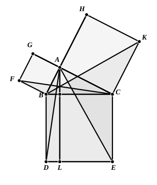

Therefore $AG$, $CF$ are parallel.

Also, since each of the alternate angles $AFG$, $FGC$ is half a right angle,  
$AF$, $CG$ are parallel.

Hence $AFCG$ is a parallelogram; and $AF$, $CG$ are equal.

Thus the triangles $ABF$, $CBG$ have two angles and one side respectively  
equal;  
therefore $AB$ is equal to $BC$, and $BF$ to $BG$.

---

### PROPOSITION 47.

In right-angled triangles the square on the side subtending 
the right angle is equal to the squares on the sides containing 
the right angle.

Let $ABC$ be a right-angled triangle having the angle  
5 $BAC$ right;  
I say that the square on $BC$ is equal to the squares on $BA$, $AC$.

For let there be described on $BC$ the square $BDEC$,  
10 and on $BA$, $AC$ the squares $GB$, $HC$; [I. 46]  
through $A$ let $AL$ be drawn parallel to either $BD$ or $CE$,  
and let $AD$, $FC$ be joined.

15 Then, since each of the angles $BAC$, $BAG$ is right,  
it follows that with a straight line $BA$, and at the point $A$ on it, the two straight lines  
20 $AC$, $AG$ not lying on the same side make the adjacent angles equal to two right angles;

therefore $CA$ is in a straight line with $AG$. [I. 14]

25 For the same reason 
$BA$ is also in a straight line with $AH$.

And, since the angle $DBC$ is equal to the angle $FBA$: for each is right:  
let the angle $ABC$ be added to each;

30 therefore the whole angle $DBA$ is equal to the whole angle $FBC$. [C. N. 2]

