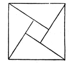
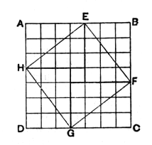

to the sum of the squares on $a, b$. All that can be said against this conjectural proof is that it has no specifically Greek colouring but rather recalls the Indian method. Thus Bhāskara (born 1114 A.D.; see Cantor, I₃, p. 656) simply draws four right-angled triangles equal to the original one inwards, one on each side of the square on the hypotenuse, and says “see!”, without even adding that inspection shows that

$$
c^2 = 4\frac{ab}{2} + (a-b)^2 = a^2 + b^2.
$$

Though, for the reason given, there is difficulty in supposing that Pythagoras used a general proof of this kind, which applies of course to right-angled triangles with sides incommensurable as well as commensurable, there is no objection, I think, to supposing that the truth of the proposition in the case of the first rational right-angled triangles discovered, *e.g.* 3, 4, 5, was proved by a method of this sort. Where the sides are commensurable in this way, the squares can be divided up into small (unit) squares, which would much facilitate the comparison between them. That this subdivision was in fact resorted to in adding and subtracting squares is made probable by Aristotle's allusion to odd numbers as *gnomons* placed round unity to form successive squares in *Physics* III. 4; this must mean that the squares were represented by dots arranged in the form of a square and a gnomon formed of dots put round, or that (if the given square was drawn in the usual way) the gnomon was divided up into unit squares. Zeuthen has shown (“*Théorème de Pythagore*,” *Origine de la Géométrie scientifique* in *Comptes rendus du II**me* *Congrès international de Philosophie*, Genève, 1904), how easily the proposition could be proved by a method of this kind for the triangle 3, 4, 5. To admit of the two smaller squares being shown side by side, take a square on a line containing 7 units of length ($4 + 3$), and divide it up into 49 small squares. It would be obvious that the whole square could be exhibited as containing four rectangles of sides 4, 3 cyclically arranged round the figure with one unit square in the middle. (This same figure is given by Cantor, I₃, p. 680, to illustrate the method given in the Chinese “Chóu-peï”.) It would be seen that

(i) the whole square ($7^2$) is made up of two squares $3^2$ and $4^2$, and two rectangles 3, 4;

(ii) the same square is made up of the square $EFGH$ and the halves of four of the same rectangles 3, 4, whence the square $EFGH$, being equal to the sum of the squares $3^2$ and $4^2$, must contain 25 unit squares and its side, or the diagonal of one of the rectangles, must contain 5 units of length.

Or the result might equally be seen by observing that

(i) the square $EFGH$ on the diagonal of one of the rectangles is made up of the halves of four rectangles and the unit square in the middle, while

(ii) the squares $3^2$ and $4^2$ placed at adjacent corners of the large square make up two rectangles 3, 4 with the unit square in the middle.

The procedure would be equally easy for any rational right-angled triangle, and would be a natural method of trying to *prove* the property when it had
