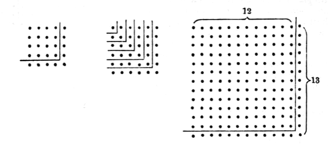
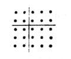

In order that $a$ and $a + 1$ may be integral, $n$ must be odd, and we have at once the Pythagorean formula
$$n^2 + \left(\frac{n^2 - 1}{2}\right)^2 = \left(\frac{n^2 + 1}{2}\right)^2.$$
I think Treutlein's hypothesis is shown to be the correct one by the passage in Aristotle's *Physics* already quoted, where the reference is undoubtedly to the Pythagoreans, and odd numbers are clearly identified with *gnomons* “placed round 1.” But the ancient commentaries on the passage make the matter clearer still. Philoponus says: “As a proof...the Pythagoreans refer to what

happens with the addition of numbers; for when the odd numbers are successively added to a square number they keep it square and equilateral.... Odd numbers are accordingly called *gnomons* because, when added to what are already squares, they preserve the square form....Alexander has excellently said in explanation that the phrase ‘when gnomons are placed round’ means *making a figure* with the odd numbers (τὴν κατὰ τοὺς περιττοὺς ἀριθμοὺς σχηματογραφίαν)...for it is the practice with the Pythagoreans to *represent things in figures* (σχηματογραφεῖν).”

The next question is: assuming this explanation of the Pythagorean formula, what are we to say of the origin of Plato's? It could of course be obtained as a particular case of the general formula of Eucl. X. already referred to; but there are two simple alternative explanations in this case also. (1) Bretschneider observes that, to obtain Plato's formula, we have only to double the sides of the squares in the Pythagorean formula,
for
$$(2n)^2 + (n^2 - 1)^2 = (n^2 + 1)^2,$$
where however $n$ is not necessarily odd.

(2) Treutlein would explain by means of an extension of the gnomon idea. As, he says, the Pythagorean formula was obtained by placing a gnomon consisting of a single row of dots round two adjacent sides of a square, it would be natural to try whether another solution could not be found by placing round the square a gnomon consisting of a *double* row of dots. Such a gnomon would equally turn the square into a larger square; and the question would be whether the double-row gnomon itself could be a square. If the side of the original square was $a$, it would easily be seen that the number of units in the double-row gnomon would be $4a + 4$, and we have only to put
$$4a + 4 = 4n^2,$$

