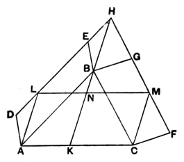

Hence the hexagons $ADEFGC$, $ABCHLK$ are equal.

Subtracting from the former the two triangles $ABC$, $EBF$, and from the latter the two equal triangles $ABC$, $HLK$, we prove that
the square $CK$ is equal to the sum of the squares $AE$, $CF$.

### Pappus' extension of I. 47.

In this elegant extension the triangle may be *any* triangle (not necessarily right-angled), and *any* parallelograms take the place of squares on two of the sides.

Pappus (IV. p. 177) enunciates the theorem as follows:

*If $ABC$ be a triangle, and any parallelograms whatever $ABED$, $BCFG$ be described on $AB$, $BC$, and if $DE$, $FG$ be produced to $H$, and $HB$ be joined, the parallelograms $ABED$, $BCFG$ are equal to the parallelogram contained by $AC$, $HB$ in an angle which is equal to the sum of the angles $BAC$, $DHB$.*

Produce $HB$ to $K$; through $A$, $C$ draw $AL$, $CM$ parallel to $HK$, and join $LM$.

Then, since $ALHB$ is a parallelogram, $AL$, $HB$ are equal and parallel.

Similarly $MC$, $HB$ are equal and parallel.

Therefore $AL$, $MC$ are equal and parallel;
whence $LM$, $AC$ are also equal and parallel,
and $ALMC$ is a parallelogram.

Further, the angle $LAC$ of this parallelogram is equal to the sum of the angles $BAC$, $DHB$, since the angle $DHB$ is equal to the angle $LAB$.

Now, since the parallelogram $DABE$ is equal to the parallelogram $LABH$ (for they are on the same base $AB$ and in the same parallels $AB$, $DH$),
and likewise $LABH$ is equal to $LAKN$ (for they are on the same base $LA$ and in the same parallels $LA$, $HK$),
the parallelogram $DABE$ is equal to the parallelogram $LAKN$.

For the same reason,
the parallelogram $BGFC$ is equal to the parallelogram $NKCM$.

Therefore the sum of the parallelograms $DABE$, $BGFC$ is equal to the parallelogram $LACM$, that is, to the parallelogram which is contained by $AC$, $HB$ in an angle $LAC$ which is equal to the sum of the angles $BAC$, $BHD$.

"And this is far more general than what is proved in the Elements about squares in the case of right-angled (triangles)."

### Heron's proof that AL, BK, CF in Euclid's figure meet in a point.

The final words of Proclus' note on I. 47 (p. 429, 9—15) are historically interesting. He says: "The demonstration by the writer of the Elements being clear, I consider that it is unnecessary to add anything further, and that we may be satisfied with what has been written, since in fact those who have added anything more, like Pappus and Heron, were obliged to draw upon what is proved in the sixth Book, for no really useful object." These words cannot
