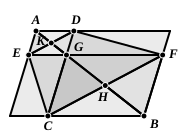

of course refer to the extension of I. 47 given by Pappus; but the key to them, so far as Heron is concerned, is to be found in the commentary of an-Nairīzī (pp. 175—185, ed. Besthorn-Heiberg; pp. 78—84, ed. Curtze) on I. 47, wherein he gives Heron's proof that the lines $AL$, $FC$, $BK$ in Euclid's figure meet in a point. Heron proved this by means of three lemmas which would most naturally be proved from the principle of similitude as laid down in Book VI., but which Heron, as a *tour de force*, proved on the principles of Book I. only. The *first* lemma is to the following effect.

*If, in a triangle $ABC$, $DE$ be drawn parallel to the base $BC$, and if $AF$ be drawn from the vertex $A$ to the middle point $F$ of $BC$, then $AF$ will also bisect $DE$.*

This is proved by drawing $HK$ through $A$ parallel to $DE$ or $BC$, and $HDL$, $KEM$ through $D$, $E$ respectively parallel to $AGF$, and lastly joining $DF$, $EF$.

Then the triangles $ABF$, $AFC$ are equal (being on equal bases), and the triangles $DBF$, $EFC$ are also equal (being on equal bases and between the same parallels).

Therefore, by subtraction, the triangles $ADF$, $AEF$ are equal, and hence the parallelograms $AL$, $AM$ are equal.

These parallelograms are between the same parallels $LM$, $HK$; therefore $LF$, $FM$ are equal, whence $DG$, $GE$ are also equal.

The *second* lemma is an extension of this to the case where $DE$ meets $BA$, $CA$ produced beyond $A$.

The *third* lemma proves the converse of Euclid I. 43, that, *If a parallelogram $AB$ is cut into four others $ADGE$, $DF$, $FGCB$, $CE$, so that $DF$, $CE$ are equal, the common vertex $G$ will be on the diagonal $AB$.*

Heron produces $AG$ till it meets $CF$ in $H$. Then, if we join $HB$, we have to prove that $AHB$ is one straight line. The proof is as follows. Since the areas $DF$, $EC$ are equal, the triangles $DGF$, $ECG$ are equal.

If we add to each the triangle $GCF$,
the triangles $ECF$, $DCF$ are equal;
therefore $ED$, $CF$ are parallel.

Now it follows from I. 34, 29 and 26 that the triangles $AKE$, $GKD$ are equal in all respects;
therefore $EK$ is equal to $KD$.

Hence, by the second lemma,
$CH$ is equal to $HF$.

Therefore, in the triangles $FHB$, $CHG$,
the two sides $BF$, $FH$ are equal to the two sides $GC$, $CH$,
and the angle $BFH$ is equal to the angle $GCH$;
hence the triangles are equal in all respects,
and the angle $BHF$ is equal to the angle $GHC$.

Adding to each the angle $GHF$, we find that the angles $BHF$, $FHG$ are equal to the angles $CHG$, $GHF$,
and therefore to two right angles.

Therefore $AHB$ is a straight line.
