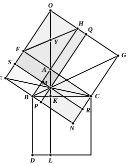

Heron now proceeds to prove the proposition that, in the accompanying figure, if $AKL$ perpendicular to $BC$ meet $EC$ in $M$, and if $BM, MG$ be joined,
$BM, MG$ are in one straight line.

Parallelograms are completed as shown in the figure, and the diagonals $OA, FH$ of the parallelogram $FH$ are drawn.

Then the triangles $FAH, BAC$ are clearly equal in all respects;
therefore the angle $HFA$ is equal to the angle $ABC$, and therefore to the angle $CAK$ (since $AK$ is perpendicular to $BC$).

But, the diagonals of the rectangle $FH$ cutting one another in $Y$,
$FY$ is equal to $YA$,
and the angle $HFA$ is equal to the angle $OAF$.

Therefore the angles $OAF, CAK$ are equal, and accordingly
$OA, AK$ are in a straight line.

Hence $OM$ is the diagonal of $SQ$;
therefore $AS$ is equal to $AQ$,
and, if we add $AM$ to each,
$FM$ is equal to $MH$.

But, since $EC$ is the diagonal of the parallelogram $FN$,
$FM$ is equal to $MN$.

Therefore $MH$ is equal to $MN$;
and, by the third lemma, $BM, MG$ are in a straight line.

### PROPOSITION 48.

*If in a triangle the square on one of the sides be equal to the squares on the remaining two sides of the triangle, the angle contained by the remaining two sides of the triangle is right.*

For in the triangle $ABC$ let the square on one side $BC$ be equal to the squares on the sides $BA, AC$;

I say that the angle $BAC$ is right.

For let $AD$ be drawn from the point $A$ at right angles to the straight line $AC$, let $AD$ be made equal to $BA$, and let $DC$ be joined.

Since $DA$ is equal to $AB$,
the square on $DA$ is also equal to the square on $AB$.

Let the square on $AC$ be added to each;
