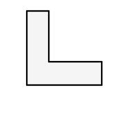
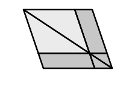

measurement of time by shadows thrown by the sun, and that the word signified the placing of a staff perpendicular to the horizon. This is borne out by the statement of Proclus that Oenopides of Chios, who first investigated the problem (Eucl. I. 12) of drawing a perpendicular from an external point to a given straight line, called the perpendicular a straight line drawn "*gnomon-wise*" (κατὰ γνώμονα). Then (2) we find the term used of a mechanical instrument for drawing right angles, as shown in the figure annexed. This seems to be the meaning in Theognis 805, where it is said that the envoy sent to consult the oracle at Delphi should be "straighter (ἰθύτερος) than the τόρνος, the στάθμη and the *gnomon*," and all three words evidently denote appliances, the τόρνος being an instrument for drawing a circle (probably a string stretched between a fixed and a moving point), and the στάθμη a plumb-line.

Next (3) it was natural that the *gnomon*, owing to its shape, should become the figure which remained of a square when a smaller square was cut out of one corner (or the figure, as Aristotle says, which when *added* to a square increases its size but does not alter its form). We have seen (note on I. 47, p. 351) that the Pythagoreans used the term in this sense, and further applied it, by analogy, to the series of odd numbers as having the same property in relation to square *numbers*. The earliest evidence for this is the fragment of Philolaus (*c.* 460 B.C.) already mentioned (see Boeckh, *Philolaos des Pythagoreers Lehren*, p. 141) where he says that "number makes all things knowable and mutually agreeing (ποτάγορα ἀλλάλοις) in the way characteristic of the gnomon" (κατὰ γνώμονος φύσιν). As Boeckh says (p. 144), it would appear from the fragment that the connexion between the gnomon and the square to which it is added was regarded as symbolical of union and agreement, and that Philolaus used the idea to explain the knowledge of things, making the *knowing* embrace and grasp the *known* as the gnomon does the square. Cf. Scholium II. No. 11 (Euclid, ed. Heiberg, Vol. V. p. 225), which says "It is to be noted that the gnomon was discovered by geometers with a view to brevity, while the name came from its incidental property, namely that from it the whole is known, whether of the whole area or of the remainder, when it is either placed round or taken away. In sundials too its sole function is to make the actual time of day known."

The geometrical meaning of the word is extended in the definition of *gnomon* given by Euclid, where (4) the gnomon has the same relation to *any parallelogram* as it before had to a *square*. From the fact that Euclid says "*let*" the figure described "*be called a gnomon*" we may infer that he was using the word in the wider sense for the first time. Later still (5) we find Heron of Alexandria defining a *gnomon in general* as any figure which, when added to any figure whatever, makes the whole figure similar to that to which it is added.

In this definition of Heron (Def. 58) Hultsch brackets the words which make it apply to any *number* as well; but Theon of Smyrna, who explains that plane, triangular, square, solid and other kinds of numbers are so called after the likeness of the areas which they measure, does make the term in its most general sense apply to numbers. "All the successive numbers which [by being successively added] produce triangles or squares or polygons are called gnomons" (p. 37, 11—13, ed. Hiller). Thus the successive odd numbers added
