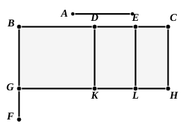

# BOOK II. PROPOSITIONS.

### PROPOSITION 1.

If there be two straight lines, and one of them be cut into 
any number of segments whatever, the rectangle contained by 
the two straight lines is equal to the rectangles contained by the 
uncut straight line and each of the segments.

5 Let $A$, $BC$ be two straight lines, and let $BC$ be cut at random at the points $D$, $E$;  
I say that the rectangle contained by $A$, $BC$ is equal to the rectangle contained by $A$, $BD$, that contained by $A$, $DE$ and 10 that contained by $A$, $EC$.

For let $BF$ be drawn from $B$ at right angles to $BC$; [I. 11]  
let $BG$ be made equal to $A$, [I. 3]  
through $G$ let $GH$ be drawn 15 parallel to $BC$, [I. 31]  
and through $D$, $E$, $C$ let $DK$, $EL$, $CH$ be drawn parallel to $BG$.

Then $BH$ is equal to $BK$, $DL$, $EH$.

20 Now $BH$ is the rectangle $A$, $BC$, for it is contained by $GB$, $BC$, and $BG$ is equal to $A$;  

$BK$ is the rectangle $A$, $BD$, for it is contained by $GB$, $BD$, and $BG$ is equal to $A$;
  

and $DL$ is the rectangle $A$, $DE$, for $DK$, that is $BG$ [I. 34], 25 is equal to $A$.
  

Similarly also $EH$ is the rectangle $A$, $EC$.

Therefore the rectangle $A$, $BC$ is equal to the rectangle $A$, $BD$, the rectangle $A$, $DE$ and the rectangle $A$, $EC$.

Therefore etc. Q. E. D.

