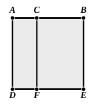

**20. the rectangle $A$, $BC$.** From this point onward I shall translate thus in cases where Euclid leaves out the word *contained* (περιεχόμενον). Though the word "rectangle" is also omitted in the Greek (the neuter article being sufficient to show that the rectangle is meant), it cannot be dispensed with in English. De Morgan advises the use of the expression "the rectangle *under* two lines." This does not seem to me a very good expression, and, if used in a translation from the Greek, it might suggest that ὑπό in τὸ ὑπό meant *under*, which it does not.

This proposition, the geometrical equivalent of the algebraical formula
\[
a(b + c + d + \dots) = ab + ac + ad + \dots,
\]
can, of course, easily be extended so as to correspond to the more general algebraical proposition that the product of an expression consisting of any number of terms added together and another expression also consisting of any number of terms added together is equal to the sum of all the products obtained by multiplying each term of one expression by all the terms of the other expression, one after another. The geometrical proof of the more general proposition would be effected by means of a figure showing all the rectangles corresponding to the partial products, in the same way as they are shown in the simpler case of II. 1; the difference would be that a series of parallels to $BC$ would have to be drawn as well as the series of parallels to $BF$.

---

### PROPOSITION 2.

If a straight line be cut at random, the rectangle contained 
by the whole and both of the segments is equal to the square on 
the whole.

For let the straight line $AB$ be cut at random at the point $C$;  
I say that the rectangle contained by $AB$, $BC$ together with the rectangle contained by $BA$, $AC$ is equal to the square on $AB$.

For let the square ">$ADEB$ be described on $AB$ [I. 46], and let $CF$ be drawn through $C$ parallel to either $AD$ or $BE$. [I. 31]

Then ">$AE$ is equal to ">$AF$, ">$CE$.

Now ">$AE$ is the square on $AB$;  

">$AF$ is the rectangle contained by $BA$, $AC$, for it is contained by $DA$, $AC$, and $AD$ is equal to $AB$;
  

and ">$CE$ is the rectangle $AB$, $BC$, for $BE$ is equal to $AB$.

Therefore the rectangle $BA$, $AC$ together with the rectangle $AB$, $BC$ is equal to the square on $AB$.

Therefore etc. Q. E. D.

