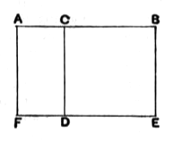

120 words, of which 8 represent the construction. Euclid's as above translated has 126 words, of which 22 are descriptive of the construction; therefore the actual *proof* by Euclid has 8 words fewer than Mr Taylor's, and the extra words due to the construction in Euclid are much more than atoned for by the advantage of picturing the result in the figure.

The advantages then which Euclid's method may claim are, I think, these: in the case of II. 2, 3 it produces the result more easily and clearly than does the alternative proof by means of II. 1, and, in its general application, it is more powerful in that it makes us independent of any recollection of results.

---

## Proposition 3.

*If a straight line be cut at random, the rectangle contained by the whole and one of the segments is equal to the rectangle contained by the segments and the square on the aforesaid segment.*

For let the straight line $AB$ be cut at random at $C$;
I say that the rectangle contained by $AB$, $BC$ is equal to the rectangle contained by $AC$, $CB$ together with the square on $BC$.

For let the square $CDEB$ be described on $CB$; [I. 46]
let $ED$ be drawn through to $F$,
and through $A$ let $AF$ be drawn parallel to either $CD$ or $BE$. [I. 31]

Then $AE$ is equal to $AD$, $CE$.

Now $AE$ is the rectangle contained by $AB$, $BC$, for it is contained by $AB$, $BE$, and $BE$ is equal to $BC$;
$AD$ is the rectangle $AC$, $CB$, for $DC$ is equal to $CB$;
and $DB$ is the square on $CB$.

Therefore the rectangle contained by $AB$, $BC$ is equal to the rectangle contained by $AC$, $CB$ together with the square on $BC$.
Therefore etc.

Q. E. D.

---

If we leave out of account the contents of Book II. itself and merely look to the applicability of propositions to general use, this proposition and the preceding are, as already indicated, of great importance, and particularly so to the semi-algebraical method just described, which seems to have found its first exponents in Heron and Pappus. Thus the proposition that *the difference of the squares on two straight lines is equal to the rectangle contained by the sum*
