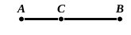
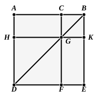

*and the difference of the straight lines*, which is generally given as equivalent to II. 5, 6, can be proved by means of II. 1, 2, 3, as shown by Lardner. For suppose the given straight lines are $AB$, $BC$, the latter being measured along $BA$.

Then, by II. 2, the square on $AB$ is equal to the sum of the rectangles $AB$, $BC$ and $AB$, $AC$.

By II. 3, the rectangle $AB$, $BC$ is equal to the sum of the square on $BC$ and the rectangle $AC$, $CB$.

Therefore the square on $AB$ is equal to the square $BC$ together with the sum of the rectangles $AC$, $AB$ and $AC$, $CB$.

But, by II. 1, the sum of the latter rectangles is equal to the rectangle contained by $AC$ and the sum of $AB$, $BC$, i.e. the rectangle contained by the sum and difference of $AB$, $BC$.

Hence the square on $AB$ is equal to the square on $BC$ and the rectangle contained by the sum and difference of $AB$, $BC$;  
that is, the difference of the squares on $AB$, $BC$ is equal to the rectangle contained by the sum and difference of $AB$, $BC$.

---

### PROPOSITION 4.

If a straight line be cut at random, the square on the whole 
is equal to the squares on the segments and twice the rectangle 
contained by the segments.

For let the straight line $AB$ be cut at random at $C$;  
5 I say that the square on $AB$ is equal to the squares on $AC$, $CB$ and twice the rectangle contained by $AC$, $CB$.

For let the square $ADEB$ be described on $AB$, [I. 46]  
10 let $BD$ be joined;  
through $C$ let $CF$ be drawn parallel to either $AD$ or $EB$,  
and through $G$ let $HK$ be drawn parallel to either $AB$ or $DE$. [I. 31]

15 Then, since $CF$ is parallel to $AD$, and $BD$ has fallen on them,  
the exterior angle $CGB$ is equal to the interior and opposite angle $ADB$. [I. 29]

But the angle $ADB$ is equal to the angle $ABD$,  
20 since the side $BA$ is also equal to $AD$; [I. 5]  
therefore the angle $CGB$ is also equal to the angle $GBC$,  
so that the side $BC$ is also equal to the side $CG$. [I. 6]
