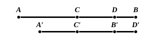

But $AH$ is the rectangle $AD$, $DB$, for $DH$ is equal to $DB$,
therefore the gnomon $NOP$ [^383_2] is also equal to the rectangle $AD$, $DB$.

Let $LG$, which is equal to the square on $CD$, be added to each;
therefore the gnomon $NOP$ and $LG$ are equal to the rectangle contained by $AD$, $DB$ and the square on $CD$.

But the gnomon $NOP$ and $LG$ are the whole square $CEFB$, which is described on $CB$;
therefore the rectangle contained by $AD$, $DB$ together with the square on $CD$ is equal to the square on $CB$. [^383_1]

Therefore etc.

Q. E. D.

[^383_1]: 3. **between the points of section,** literally "between the sections," the word being the same (τομή) as that used of a conic *section*.
[^383_2]: It will be observed that the gnomon is indicated in the figure by three separate letters and a dotted curve. This is no doubt a clearer way of showing what exactly the gnomon is than the method usual in our text-books. In this particular case the figure of the MSS. has *two* M's in it, the gnomon being ΜΝΞ. I have corrected the lettering to avoid confusion.

---

It is easily seen that this proposition and the next give exactly the theorem already alluded to under the last propositions, namely that *the difference of the squares on two straight lines is equal to the rectangle contained by their sum and difference*. The two given lines are, in II. 5, the lines $CB$ and $CD$, and their sum and difference are respectively equal to $AD$ and $DB$. To show that II. 6 gives the same theorem we have only to make $CD$ the greater line and $CB$ the less, i.e. to draw $C'D'$ equal to $CB$, measure $CB'$ along it equal to $CD$, and then produce $BC'$ to $A'$, making $A'C'$ equal to $B'C'$, whence it is immediately clear that $A'D'$ on the second line is equal to $AD$ on the first, while $D'B'$ is also equal to $DB$, so that the rectangles $AD$, $DB$ and $A'D'$, $D'B'$ are equal, while the difference of the squares on $CB$, $CD$ is equal to the difference of the squares on $C'D'$, $C'B'$.

Perhaps the most important fact about II. 5, 6 is however their bearing on the

### Geometrical solution of a quadratic equation.

Suppose, in the figure of II. 5, that $AB = a$, $DB = x$;
then
$$ax - x^2 = \text{the rectangle } AH$$
$$= \text{the gnomon } NOP.$$

Thus, if the area of the gnomon is given ($= b^2$, say), and if $a$ is given ($= AB$), the problem of solving the equation
$$ax - x^2 = b^2$$
is, in the language of geometry, *To a given straight line ($a$) to apply a rectangle which shall be equal to a given square ($b^2$) and shall fall short by a square figure*, i.e. to construct the rectangle $AH$ or the gnomon $NOP$.

Now we are told by Proclus (on I. 44) that "these propositions are ancient
