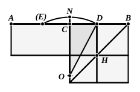

and the discoveries of the Muse of the Pythagoreans, the application of areas, their exceeding and their falling-short." We can therefore hardly avoid crediting the Pythagoreans with the geometrical solution, based upon II. 5, 6, of the problems corresponding to the quadratic equations which are directly obtainable from them. It is certain that the Pythagoreans solved the problem in II. 11, which corresponds to the quadratic equation
$$a(a - x) = x^2,$$
and Simson has suggested the following easy solution of the equation now in question,
$$ax - x^2 = b^2,$$
on exactly similar lines.

Draw $CO$ perpendicular to $AB$ and equal to $b$; produce $OC$ to $N$ so that $ON = CB$ (or $\frac{1}{2}a$); and with $O$ as centre and radius $ON$ describe a circle cutting $CB$ in $D$.

Then $DB$ (or $x$) is found, and therefore the required rectangle $AH$.

For the rectangle $AD$, $DB$ together with the square on $CD$ is equal to the square on $CB$, [II. 5]
i.e. to the square on $OD$,
i.e. to the squares on $OC$, $CD$; [I. 47]
whence the rectangle $AD$, $DB$ is equal to the square on $OC$,
or
$$ax - x^2 = b^2.$$

It is of course a necessary condition of the possibility of a real solution that $b^2$ must not be greater than $(\frac{1}{2}a)^2$. This condition itself can easily be obtained from Euclid's proposition; for, since the sum of the rectangle $AD$, $DB$ and the square on $CD$ is equal to the square on $CB$, which is constant, it follows that, as $CD$ diminishes, i.e. as $D$ moves nearer to $C$, the rectangle $AD$, $DB$ increases and, when $D$ actually coincides with $C$, so that $CD$ vanishes, the rectangle $AD$, $DB$ becomes the rectangle $AC$, $CB$, i.e. the square on $CB$, and is a maximum. It will be seen also that the geometrical solution of the quadratic equation derived from Euclid does not differ from our practice of solving a quadratic by completing the square on the side containing the terms in $x^2$ and $x$.

But, while in this case there are two geometrically real solutions (because the circle described with $ON$ as radius will not only cut $CB$ in $D$ but will also cut $AC$ in another point $E$), Euclid's figure corresponds to one only of the two solutions. Not that there is any doubt that Euclid was aware that the method of solving the quadratic gives two solutions; he could not fail to see that $x = BE$ satisfies the equation as well as $x = BD$. If however he had actually given us the solution of the equation, he would probably have omitted to specify the solution $x = BE$ because the rectangle found by means of it, which would be a rectangle on the base $AE$ (equal to $BD$) and with altitude $EB$ (equal to $AD$), is really an equal rectangle to that corresponding to the other solution $x = BD$; there is therefore no real object in distinguishing two solutions. This is easily understood when we regard the equation as a statement of the problem of finding two magnitudes when their sum ($a$) and product ($b^2$) are given, i.e. as equivalent to the simultaneous equations
$$x + y = a,$$
$$xy = b^2.$$
