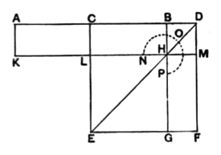

through the point $H$ let $KM$ be drawn parallel to either $AB$ or $EF$,
and further through $A$ let $AK$ be drawn parallel to either $CL$ or $DM$. [I. 31]

Then, since $AC$ is equal to $CB$,
$AL$ is also equal to $CH$. [I. 36]
But $CH$ is equal to $HF$. [I. 43]
Therefore $AL$ is also equal to $HF$.

Let $CM$ be added to each;
therefore the whole $AM$ is equal to the gnomon $NOP$.

But $AM$ is the rectangle $AD$, $DB$,
for $DM$ is equal to $DB$;
therefore the gnomon $NOP$ is also equal to the rectangle $AD$, $DB$.

Let $LG$, which is equal to the square on $BC$, be added to each;
therefore the rectangle contained by $AD$, $DB$ together with the square on $CB$ is equal to the gnomon $NOP$ and $LG$.

But the gnomon $NOP$ and $LG$ are the whole square $CEFD$, which is described on $CD$;
therefore the rectangle contained by $AD$, $DB$ together with the square on $CB$ is equal to the square on $CD$.

Therefore etc.

Q. E. D.

---

In this case the rectangle $AD$, $DB$ is "a rectangle applied to a given straight line ($AB$) but *exceeding* by a square (the side of which is equal to $BD$)"; and the problem suggested by II. 6 is to find a rectangle of this description equal to a given area, which we will, for convenience, suppose to be a square; i.e., in the language of geometry, *to apply to a given straight line a rectangle which shall be equal to a given square and shall exceed by a square figure*.

We suppose that in Euclid's figure $AB = a$, $BD = x$; then, if the given square be $b^2$, the problem is to solve geometrically the equation
$$ax + x^2 = b^2.$$

The solution of a problem theoretically equivalent to the solution of a quadratic equation of this kind is presupposed in the fragment of Hippocrates' *Quadrature of lunes* preserved in a quotation by Simplicius (*Comment. in*
