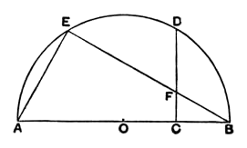
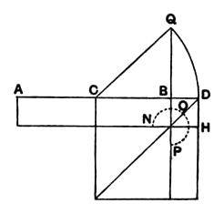

*Aristot. Phys.* pp. 61—68, ed. Diels) from Eudemus' *History of Geometry*. In this fragment Hippocrates (5th cent. B.C.) assumes the following construction.

$AB$ being the diameter and $O$ the centre of a semicircle, and $C$ being the middle point of $OB$ and $CD$ at right angles to $AB$, a straight line of length such that its square is $1\frac{1}{2}$ times the square on the radius (i.e. of length $a\sqrt{\frac{3}{2}}$, where $a$ is the radius) is to be so placed, as $EF$, between $CD$ and the circumference $AD$ that it "verges towards $B$," that is, $EF$ when produced passes through $B$.

Now the right-angled triangles $BFC$, $BAE$ are similar, so that
$$BF : BC = BA : BE,$$
and therefore the rectangle $BE, BF = \text{rect. } BA, BC$
$$= \text{sq. on } BO.$$

In other words, $EF$ ($= a\sqrt{\frac{3}{2}}$) being given in length, $BF$ ($= x$, say) has to be found such that
$$\left(\sqrt{\frac{3}{2}}a + x\right)x = a^2;$$
or the quadratic equation
$$\sqrt{\frac{3}{2}}ax + x^2 = a^2$$
has to be solved.

A straight line of length $a\sqrt{\frac{3}{2}}$ would easily be constructed, for, in the figure, $CD^2 = AC \cdot CB = \frac{3}{4}a^2$, or $CD = \frac{1}{2}a\sqrt{3}$, and $a\sqrt{\frac{3}{2}}$ is the diagonal of a square of which $CD$ is the side.

There is no doubt that Hippocrates could have solved the equation by the geometrical construction given below, but he may have contemplated, on this occasion, the merely *mechanical* process of *placing* the straight line of the length required between $CD$ and the circumference $AD$ and *moving* it until $E, F, B$ were in a straight line. Zeuthen (*Die Lehre von den Kegelschnitten im Altertum*, pp. 270, 271) thinks this probable because, curiously enough, the fragment speaks immediately afterwards of "joining $B$ to $F$."

To solve the equation
$$ax + x^2 = b^2$$
we have to find the rectangle $AH$, or the gnomon $NOP$, which is equal in area to $b^2$ and has one of the sides containing the inner right angle equal to $CB$ or $\frac{1}{2}a$. Thus we know $\left(\frac{1}{2}a\right)^2$ and $b^2$, and we have to find, by I. 47, a square equal to the sum of two given squares.

To do this Simson draws $BQ$ at right angles to $AB$ and equal to $b$, joins $CQ$ and, with centre $C$ and radius $CQ$, describes a circle cutting $AB$ produced in $D$. Thus $BD$, or $x$, is found.

Now the rectangle $AD, DB$ together with the square on $CB$
is equal to the square on $CD$,
i.e. to the square on $CQ$,
i.e. to the squares on $CB, BQ$.
