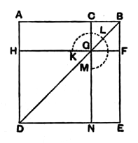

Therefore the rectangle $AD, DB$ is equal to the square on $BQ$, that is,
\[
ax + x^2 = b^2.
\]
From Euclid's point of view there would only be one solution in this case.

This proposition enables us also to solve the equation
\[
x^2 - ax = b^2
\]
in a similar manner.

We have only to suppose that $AB = a$, and $AD$ (instead of $BD$) $= x$; then
\[
x^2 - ax = \text{the gnomon.}
\]
To find the gnomon we have its area ($b^2$) and the area, $CB^2$ or $\left(\frac{1}{2}a\right)^2$, by which the gnomon differs from $CD^2$. Thus we can find $D$ (and therefore $AD$ or $x$) by the same construction as that just given.

Converse propositions to II. 5, 6 are given by Pappus (VII. pp. 948—950) among his lemmas to the *Conics* of Apollonius to the effect that,
1. if $D$ be a point dividing $AB$ unequally, and $C$ another point on $AB$ such that the rectangle $AD, DB$ together with the square on $CD$ is equal to the square on $AC$, then
\[
AC \text{ is equal to } CB;
\]
2. if $D$ be a point on $AB$ produced, and $C$ a point on $AB$ such that the rectangle $AD, DB$ together with the square on $CB$ is equal to the square on $CD$, then
\[
AC \text{ is equal to } CB.
\]

---

### PROPOSITION 7.

If a straight line be cut at random, the square on the 
whole and that on one of the segments both together are equal 
to twice the rectangle contained by the whole and the said 
segment and the square on the remaining segment.

For let a straight line $AB$ be cut at random at the point $C$;  
I say that the squares on $AB$, $BC$ are equal to twice the rectangle contained by $AB$, $BC$ and the square on $CA$.

For let the square $ADEB$ be described on $AB$, [I. 46]  
and let the figure be drawn.

Then, since $AG$ is equal to $GE$, [I. 43]  
let $CF$ be added to each;  

therefore the whole $AF$ is equal to the whole $CE$.

Therefore $AF$, $CE$ are double of $AF$.

But $AF$, $CE$ are the gnomon $KLM$ and the square $CF$;  

therefore the gnomon $KLM$ and the square $CF$ are double of $AF$.

