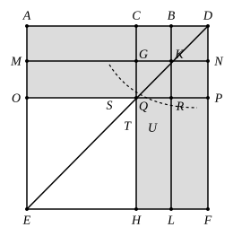

For let [the straight line] $BD$ be produced in a straight line [with $AB$], and let $BD$ be made equal to $CB$;
let the square $AEFD$ be described on $AD$, and let the figure be drawn double.

Then, since $CB$ is equal to $BD$, while $CB$ is equal to $GK$, and $BD$ to $KN$,
therefore $GK$ is also equal to $KN$.

For the same reason
$QR$ is also equal to $RP$.

And, since $BC$ is equal to $BD$, and $GK$ to $KN$,
therefore $CK$ is also equal to $KD$, and $GR$ to $RN$. [I. 36]

But $CK$ is equal to $RN$, for they are complements of the parallelogram $CP$; [I. 43]
therefore $KD$ is also equal to $GR$;
therefore the four areas $DK$, $CK$, $GR$, $RN$ are equal to one another.

Therefore the four are quadruple of $CK$.

Again, since $CB$ is equal to $BD$,
while $BD$ is equal to $BK$, that is $CG$,
and $CB$ is equal to $GK$, that is $GQ$,
therefore $CG$ is also equal to $GQ$.

And, since $CG$ is equal to $GQ$, and $QR$ to $RP$,
$AG$ is also equal to $MQ$, and $QL$ to $RF$. [I. 36]

But $MQ$ is equal to $QL$, for they are complements of the parallelogram $ML$; [I. 43]
therefore $AG$ is also equal to $RF$;
therefore the four areas $AG$, $MQ$, $QL$, $RF$ are equal to one another.

Therefore the four are quadruple of $AG$.

But the four areas $CK$, $KD$, $GR$, $RN$ were proved to be quadruple of $CK$;
therefore the eight areas, which contain the gnomon $STU$, are quadruple of $AK$.

Now, since $AK$ is the rectangle $AB$, $BD$, for $BK$ is equal to $BD$,
