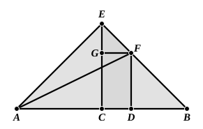

Take $BG$, $EH$, $FK$ each equal to $BC$ or $AD$, and draw $ALP$, $HNM$ parallel to $BE$ and $GML$, $KPN$ parallel to $BD$.

Then it can be shown that each of the rectangles $BL$, $AK$, $FN$, $EM$ is equal to the rectangle $AB$, $BC$, and that $PM$ is equal to the square on $AC$.

Therefore the square on $BD$ is equal to four times the rectangle $AB$, $BC$ together with the square on $AC$.

---

### PROPOSITION 9.

If a straight line be cut into equal and unequal segments, 
the squares on the unequal segments of the whole are double 
of the square on the half and of the square on the straight line 
between the points of section.

For let a straight line $AB$ be cut into equal segments at $C$, and into unequal segments at $D$;  
I say that the squares on $AD$, $DB$ are double of the squares on $AC$, $CD$.

For let $CE$ be drawn from $C$ at right angles to $AB$, and let it be made equal to either $AC$ or $CB$;  
let $EA$, $EB$ be joined,  
let $DF$ be drawn through $D$ parallel to $EC$,  
and $FG$ through $F$ parallel to $AB$,  
and let $AF$ be joined.

Then, since $AC$ is equal to $CE$,  
the angle $EAC$ is also equal to the angle $AEC$.

And, since the angle at $C$ is right,  
the remaining angles $EAC$, $AEC$ are equal to one right angle. [I. 32]

And they are equal;  

therefore each of the angles $CEA$, $CAE$ is half a right angle.

For the same reason  
each of the angles $CEB$, $EBC$ is also half a right angle;  

therefore the whole angle $AEB$ is right.

And, since the angle $GEF$ is half a right angle,
