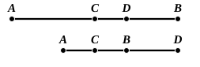
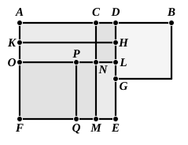

And $DF$ is equal to $DB$;  

therefore the squares on $AD$, $DB$ are double of the squares on $AC$, $CD$.

Therefore etc. Q. E. D.

---

It is noteworthy that, while the first eight propositions of Book II. are proved independently of the Pythagorean theorem I. 47, all the remaining propositions beginning with the 9th are proved by means of it. Also the 9th and 10th propositions mark a new departure in another respect; the method of demonstration by showing in the figures the various rectangles and squares to which the theorems relate is here abandoned.

The 9th and 10th propositions are related to one another in the same way as the 5th and 6th; they really prove the same result which can, as in the earlier case, be comprised in a single enunciation thus: *The sum of the squares on the sum and difference of two given straight lines is equal to twice the sum of the squares on the lines*.

The semi-algebraical proof of Prop. 9 is that suggested by the remark on the algebraical formulae given at the end of the note on II. 7. It applies with a very slight modification to both II. 9 and II. 10. We will put in brackets the variations belonging to II. 10. The first of the annexed lines is the figure for II. 9 and the second for II. 10.

By II. 4, the square on $AD$ is equal to the squares on $AC$, $CD$ and twice the rectangle $AC$, $CD$.

By II. 7, the squares on $CB$, $CD$ ($CD$, $CB$) are equal to twice the rectangle $CB$, $CD$ together with the square on $BD$.

By addition of these equals crosswise,  
the squares on $AD$, $DB$ together with twice the rectangle $CB$, $CD$ are equal to the squares on $AC$, $CD$, $CB$, $CD$ together with twice the rectangle $AC$, $CD$.

But $AC$, $CB$ are equal, and therefore the rectangles $AC$, $CD$ and $CB$, $CD$ are equal.

Taking away the equals, we see that  
the squares on $AD$, $DB$ are equal to the squares on $AC$, $CD$, $CB$, $CD$,  
i.e. to twice the squares on $AC$, $CD$.

To show also that the method of geometrical algebra illustrated by II. 1—8 is still effective for the purpose of proving II. 9, 10, we will now prove II. 9 in that manner.

Draw squares on $AD$, $DB$ respectively as shown in the figure. Measure $DH$ along $DE$ equal to $CD$, and $HL$ along $HE$ also equal to $CD$.

Draw $HK$, $LNO$ parallel to $EF$, and $CNM$ parallel to $DE$.

Measure $NP$ along $NO$ equal to $CD$, and draw $PQ$ parallel to $DE$.
