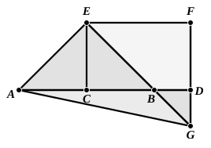

Now, since $AD$, $CD$ are respectively equal to $DE$, $DH$,
\[
HE \text{ is equal to } AC \text{ or } CB;
\]
and, since $HL$ is equal to $CD$, $LE$ is equal to $DB$.

Similarly, since each of the segments $EM$, $MQ$ is equal to $CD$,
\[
FQ \text{ is equal to } EL \text{ or } BD.
\]
Therefore $OQ$ is equal to the square on $DB$.

We have to prove that the squares on $AD$, $DB$ are equal to twice the squares on $AC$, $CD$.

Now the square on $AD$ includes $KM$ (the square on $AC$) and $CH$, $HN$ (that is, twice the square on $CD$).

Therefore we have to prove that what is left over of the square on $AD$ together with the square on $DB$ is equal to the square on $AC$.

The parts left over are the rectangles $CK$ and $NE$, which are equal to $KN$, $PM$ respectively.

But the latter with the square on $DB$ are equal to the rectangles $KN$, $PM$ and the square $OQ$,
\[
\text{i.e. to the square } KM\text{, or the square on } AC.
\]

Hence the required result follows.

---

### PROPOSITION 10.

If a straight line be bisected, and a straight line be added 
to it in a straight line, the square on the whole with the added 
straight line and the square on the added straight line both 
together are double of the square on the half and of the square 
described on the straight line made up of the half and the 
added straight line as on one straight line.

For let a straight line $AB$ be bisected at $C$, and let a straight line $BD$ be added to it in a straight line;  
I say that the squares on $AD$, $DB$ are double of the squares on $AC$, $CD$.

For let $CE$ be drawn from the point $C$ at right angles to $AB$ [I. 11], and let it be made equal to either $AC$ or $CB$ [I. 3];  
let $EA$, $EB$ be joined;  
through $E$ let $EF$ be drawn parallel to $AD$,  
and through $D$ let $FD$ be drawn parallel to $CE$. [I. 31]

Then, since a straight line $EF$ falls on the parallel straight lines $EC$, $FD$,
