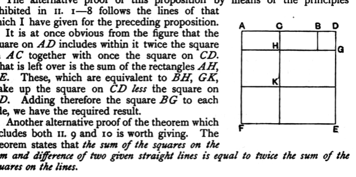

Again, since $FG$ is equal to $EF$,  
the square on $FG$ is also equal to the square on $FE$;  

therefore the squares on $GF$, $FE$ are double of the square on $EF$.

But the square on $EG$ is equal to the squares on $GF$, $FE$; [I. 47]  

therefore the square on $EG$ is double of the square on $EF$.

And $EF$ is equal to $CD$; [I. 34]  

therefore the square on $EG$ is double of the square on $CD$.

But the square on $EA$ was also proved double of the square on $AC$;  

therefore the squares on $AE$, $EG$ are double of the squares on $AC$, $CD$.

And the square on $AG$ is equal to the squares on $AE$, $EG$; [I. 47]  

therefore the square on $AG$ is double of the squares on $AC$, $CD$.

But the squares on $AD$, $DG$ are equal to the square on $AG$; [I. 47]  

therefore the squares on $AD$, $DG$ are double of the squares on $AC$, $CD$.

And $DG$ is equal to $DB$;  

therefore the squares on $AD$, $DB$ are double of the squares on $AC$, $CD$.

Therefore etc. Q. E. D.

---

The alternative proof of this proposition by means of the principles exhibited in II. 1—8 follows the lines of that which I have given for the preceding proposition.

It is at once obvious from the figure that the square on $AD$ includes within it twice the square on $AC$ together with once the square on $CD$. What is left over is the sum of the rectangles $AH$, $KE$. These, which are equivalent to $BH$, $GK$, make up the square on $CD$ *less* the square on $BD$. Adding therefore the square $BG$ to each side, we have the required result.

Another alternative proof of the theorem which includes both II. 9 and 10 is worth giving. The theorem states that *the sum of the squares on the sum and difference of two given straight lines is equal to twice the sum of the squares on the lines*.
