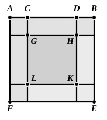
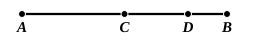

Let $AD$, $DB$ be the two given straight lines (of which $AD$ is the greater), placed so as to be in one straight line. Make $AC$ equal to $DB$ and complete the figure as shown, each of the segments $CG$ and $DH$ being equal to $AC$ or $DB$.

Now, $AD$, $DB$ being the given straight lines, $AB$ is their sum and $CD$ is equal to their difference.

Also $AD$ is equal to $BC$.

And ">$AE$ is the square on $AB$, ">$GK$ is equal to the square on $CD$, ">$AK$ or ">$FH$ is the square on $AD$, and ">$BL$ the square on $CB$, while each of the small squares ">$AG$, ">$BH$, ">$EK$, ">$FL$ is equal to the square on $AC$ or $DB$.

We have to prove that twice the squares on $AD$, $DB$ are equal to the squares on $AB$, $CD$.

Now twice the square on $AD$ is the sum of the squares on $AD$, $CB$, which is equal to the sum of the squares ">$BL$, ">$FH$; and the figure shows these to be equal to twice the inner square ">$GK$ and once the remainder of the large square ">$AE$ excluding the two squares ">$AG$, ">$KE$, which latter squares are equal to twice the square on $AC$ or $DB$.

Therefore twice the squares on $AD$, $DB$ are equal to twice the inner square ">$GK$ together with once the remainder of the large square ">$AE$, that is, to the sum of the squares ">$AE$, ">$GK$, which are the squares on $AB$, $CD$.

#### "Side" and "diagonal" numbers giving successive approximations to $\sqrt{2}$.

Zeuthen pointed out (*Die Lehre von den Kegelschnitten im Altertum*, 1886, pp. 27, 28) that II. 9, 10 have great interest in connexion with a problem of indeterminate analysis which received much attention from the ancient Greeks. If we take the straight line $AB$ divided at $C$ and $D$ as in II. 9, and if we put $CD$ $= x$, $DB$ $= y$, the result obtained by Euclid, namely:

$$AD^2 + DB^2 = 2AC^2 + 2CD^2,$$
or
$$AD^2 - 2AC^2 = 2CD^2 - DB^2,$$
becomes the formula
$$(2x + y)^2 - 2(x + y)^2 = 2x^2 - y^2.$$

If therefore $x$, $y$ be numbers which satisfy one of the two equations
$$2x^2 - y^2 = \pm 1,$$
the formula gives us two higher numbers, $x + y$ and $2x + y$, which satisfy the other of the two equations.

Euclid's propositions thus give a general proof of the very formula used for the formation of the succession of what were called "*side*" and "*diagonal* numbers."

As is well known, Theon of Smyrna (pp. 43, 44, ed. Hiller) describes this system of numbers. The unit, being the beginning of all things, must be potentially both a *side* and a *diameter*. Consequently we begin with two units, the one being the first *side* and the other the first *diameter*, and ($a$) from the sum of them, ($b$) from the sum of twice the first unit and once the second, we form two new numbers
$$1 . 1 + 1 = 2, \quad 2 . 1 + 1 = 3.$$
