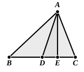
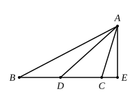

XXXI. Hist.-litt. Abt. p. 135, and Cantor, *Geschichte der Mathematik*, $\text{I}_3$, p. 437) as to the way in which the formation of the successive *side-* and *diagonal-*numbers may have been discovered, namely by observation from a very simple geometrical figure. Let $ABC$ be an isosceles triangle, right-angled at $A$, with sides $a_{n-1}$, $a_{n-1}$, $d_{n-1}$ respectively. If now the two sides $AB, AC$ about the right angle be lengthened by adding $d_{n-1}$ to each, and the extremities $D, E$ be joined, it is easily seen by means of the figure (in which $BF, CG$ are perpendicular to $DE$) that the new *diagonal* $d_n$ is equal to $2a_{n-1} + d_{n-1}$, while the equal *sides* $a_n$ are, by construction, equal to $a_{n-1} + d_{n-1}$.

### Important deductions from II. 9, 10.

I. Pappus (VII. pp. 856—8) uses II. 9, 10 for proving the well-known theorem that

*The sum of the squares on two sides of a triangle is equal to twice the square on half the base together with twice the square on the straight line joining the middle point of the base to the opposite vertex.*

Let $ABC$ be the given triangle and $D$ the middle point of the base $BC$. Join $AD$, and draw $AE$ perpendicular to $BC$ (produced if necessary).

Now, by II. 9, 10,
the squares on $BE, EC$ are equal to twice the squares on $BD, DE$.

Add to each twice the square on $AE$.

Then, remembering that
the squares on $BE, EA$ are equal to the square on $BA$,
the squares on $AE, EC$ are equal to the square on $AC$,
and the squares on $AE, ED$ are equal to the square on $AD$,
we find that
the squares on $BA, AC$ are equal to twice the squares on $AD, BD$.

The proposition is generally proved by means of II. 12, 13, but not, I think, so conveniently as by the method of Pappus.

II. The inference was early made by Gregory of St. Vincent (1584–1667) and Viviani (1622–1703) that *In any parallelogram the squares on the diagonals are together equal to the squares on the sides, or to twice the squares on adjacent sides.*

III. It appears that Leonhard Euler (1707–83) was the first to discover the corresponding theorem with reference to any quadrilateral, namely that *In any quadrilateral the sum of the squares on the sides is equal to the sum of the squares on the diagonals and four times the square on the line joining the middle*
