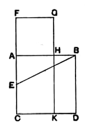

*points of the diagonals.* Euler seems however to have proved the property from the corresponding theorem for parallelograms just quoted (cf. Camerer's Euclid, Vol. I. pp. 468, 469) and not from the property of the triangle, though the latter brings out the result more easily.

---

### PROPOSITION 11.

To cut a given straight line so that the rectangle contained 
by the whole and one of the segments is equal to the square on 
the remaining segment.

Let $AB$ be the given straight line;  
thus it is required to cut $AB$ so that the rectangle contained by the whole and one of the segments is equal to the square on the remaining segment.

For let the square $ABDC$ be described on $AB$; [I. 46]  
let $AC$ be bisected at the point $E$, and let $BE$ be joined;  
let $CA$ be drawn through to $F$, and let $EF$ be made equal to $BE$;  
let the square $FH$ be described on $AF$, and let $GH$ be drawn through to $K$.

I say that $AB$ has been cut at $H$ so as to make the rectangle contained by $AB$, $BH$ equal to the square on $AH$.

For, since the straight line $AC$ has been bisected at $E$, and $FA$ is added to it,  

the rectangle contained by $CF$, $FA$ together with the square on $AE$ is equal to the square on $EF$. [II. 6]

But $EF$ is equal to $EB$;  

therefore the rectangle $CF$, $FA$ together with the square on $AE$ is equal to the square on $EB$.

But the squares on $BA$, $AE$ are equal to the square on $EB$, for the angle at $A$ is right: [I. 47]  

therefore the rectangle $CF$, $FA$ together with the square on $AE$ is equal to the squares on $BA$, $AE$.

Let the square on $AE$ be subtracted from each;  

therefore the rectangle $CF$, $FA$ which remains is equal to the square on $AB$.

