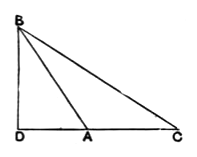

*perpendicular falls, and the straight line cut off outside by the perpendicular towards the obtuse angle.*

Let $ABC$ be an obtuse-angled triangle having the angle $BAC$ obtuse, and let $BD$ be drawn from the point $B$ perpendicular to $CA$ produced;

I say that the square on $BC$ is greater than the squares on $BA, AC$ by twice the rectangle contained by $CA, AD$.

For, since the straight line $CD$ has been cut at random at the point $A$,
the square on $DC$ is equal to the squares on $CA, AD$ and twice the rectangle contained by $CA, AD$. [II. 4]

Let the square on $DB$ be added to each;
therefore the squares on $CD, DB$ are equal to the squares on $CA, AD, DB$ and twice the rectangle $CA, AD$.

But the square on $CB$ is equal to the squares on $CD, DB$, for the angle at $D$ is right; [I. 47]
and the square on $AB$ is equal to the squares on $AD, DB$; [I. 47]
therefore the square on $CB$ is equal to the squares on $CA, AB$ and twice the rectangle contained by $CA, AD$;

so that the square on $CB$ is greater than the squares on $CA, AB$ by twice the rectangle contained by $CA, AD$.

Therefore etc.

Q. E. D.

---

Since in this proposition and the next we have to do with the squares on the sides of triangles, the particular form of graphic representation of areas which we have had in Book II. up to this point does not help us to visualise the results of the propositions in the same way, and only two lines of proof are possible, (1) by means of the *results* of certain earlier propositions in Book II. combined with the *result* of I. 47 and (2) by means of the procedure in Euclid's proof of I. 47 itself. The alternative proofs of II. 12, 13 after the manner of Euclid's proof of I. 47 are therefore alone worth giving.

These proofs appear in certain modern text-books (e.g. Mehler, Henrici and Treutlein, H. M. Taylor, Smith and Bryant). Smith and Bryant are not correct in saying (p. 142) that they cannot be traced further back than Lardner's Euclid (1828); they are to be found in Gregory of St. Vincent's work (published in 1647) *Opus geometricum quadraturae circuli et sectionum coni*, Book I. Pt. 2, Props. 44, 45 (pp. 31, 32).

To prove II. 12, take an obtuse-angled triangle $ABC$ in which the angle at $A$ is the obtuse angle
