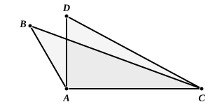

Describe squares on $BC, CA, AB$, as $BCED, CAGF, ABKH$.

Draw $AL, BM, CN$, perpendicular to $BC, CA, AB$ (produced if necessary), and produce them to meet the further sides of the squares on them in $P, Q, R$ respectively.

Join $AD, CK$.

Then, as in I. 47, the triangles $KBC, ABD$ are equal in all respects;

therefore their doubles, the parallelograms in the same parallels respectively, are equal;

that is, the rectangle $BP$ is equal to the rectangle $BR$.

Similarly the rectangle $CP$ is equal to the rectangle $CQ$.

Also, if $BG, CH$ be joined, we see that

the triangles $BAG, HAC$ are equal in all respects;

therefore their doubles, the rectangles $AQ, AR$, are equal.

Now the square on $BC$ is equal to the sum of the rectangles $BP, CP$,

i.e. to the sum of the rectangles $BR, CQ$,

i.e. to the sum of the squares $BH, CG$ and the rectangles $AR, AQ$.

But the rectangles $AR, AQ$ are equal, and they are respectively the rectangle contained by $BA, AN$ and the rectangle contained by $CA, AM$.

Therefore the square on $BC$ is equal to the squares on $BA, AC$ together with twice the rectangle $BA, AN$ or $CA, AM$.

Incidentally this proof shows that the rectangle $BA, AN$ is equal to the rectangle $CA, AM$: a result which will be seen later on to be a particular case of the theorem in III. 35.

Heron (in an-Nairīzī, ed. Curtze, p. 109) gives a "converse" of II. 12 related to it as I. 48 is related to I. 47.

*In any triangle, if the square on one of the sides is greater than the squares on the other two sides, the angle contained by the latter is obtuse.*

Let $ABC$ be a triangle such that the square on $BC$ is greater than the squares on $BA, AC$.

Draw $AD$ at right angles to $AC$ and of length equal to $AB$.

Join $DC$.

Then, since $DAC$ is a right angle, the square on $DC$ is equal to the squares on $DA, AC$, [I. 47]

i.e. to the squares on $BA, AC$.

But the square on $BC$ is greater than the squares on $BA, AC$; therefore the square on $BC$ is greater than the square on $DC$.

Therefore $BC$ is greater than $DC$.

Thus, in the triangles $BAC, DAC$, the two sides $BA, AC$ are equal to the two sides $DA, AC$ respectively,

but the base $BC$ is greater than the base $DC$.
