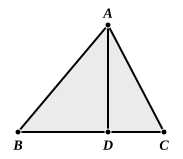

Therefore the angle $BAC$ is greater than the angle $DAC$; [I. 25]  
that is, the angle $BAC$ is obtuse.

---

### PROPOSITION 13.

In acute-angled triangles the square on the side subtending 
the acute angle is less than the squares on the sides containing 
the acute angle by twice the rectangle contained by one of the 
sides about the acute angle, namely that on which the per- 
pendicular falls, and the straight line cut off within by the 
perpendicular towards the acute angle.

Let $ABC$ be an acute-angled triangle having the angle at $B$ acute, and let $AD$ be drawn from the point $A$ perpendicular to $BC$;  
I say that the square on $AC$ is less than the squares on $CB$, $BA$ by twice the rectangle contained by $CB$, $BD$.

For, since the straight line $CB$ has been cut at random at $D$,  
the squares on $CB$, $BD$ are equal to twice the rectangle contained by $CB$, $BD$ and the square on $DC$. [II. 7]

Let the square on $DA$ be added to each;  

therefore the squares on $CB$, $BD$, $DA$ are equal to twice the rectangle contained by $CB$, $BD$ and the squares on $AD$, $DC$.

But the square on $AB$ is equal to the squares on $BD$, $DA$, for the angle at $D$ is right; [I. 47]  
and the square on $AC$ is equal to the squares on $AD$, $DC$;  

therefore the squares on $CB$, $BA$ are equal to the square on $AC$ and twice the rectangle $CB$, $BD$,

so that the square on $AC$ alone is less than the squares on $CB$, $BA$ by twice the rectangle contained by $CB$, $BD$.

Therefore etc. Q. E. D.

---

As the text stands, this proposition is unequivocally enunciated of *acute-angled* triangles; and, as if to obviate any doubt as to whether the restriction was fully intended, the enunciation speaks of the rectangle contained by one of the sides containing the acute angle and the straight line intercepted *within* by the perpendicular towards the acute angle. On the other hand, it
