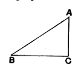
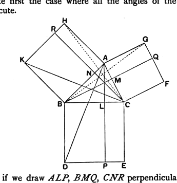

is curious that it speaks of the square on the side subtending *the* acute angle; and again the *setting-out* begins "let $ABC$ be an acute-angled triangle *having the angle at* B *acute*," though the last words have no point if all the angles of the triangle are necessarily acute.

It was however very early noticed, not only by Isaacus Monachus, Campanus, Peletarius, Clavius, Commandinus and the rest, but by the Greek scholiast (Heiberg, Vol. V. p. 253), that the relation between the sides of a triangle established by this theorem is true of the side opposite to, and the sides about, an acute angle respectively in any sort of triangle whether acute-angled, right-angled or obtuse-angled. The scholiast tries to explain away the word "acute-angled" in the enunciation: "Since in the definitions he calls acute-angled the triangle which has three acute angles, you must know that he does not mean that here, but calls all triangles acute-angled because all have an acute angle, one at least, if not all. The enunciation therefore is: 'In any triangle the square on the side subtending the acute angle is less than the squares on the sides containing the acute angle by twice the rectangle, etc.'"

We may judge too by Heron's enunciation of his "converse" of the proposition that he would have left the word "acute-angled" out of the enunciation. His converse is: *In any triangle in which the square on one of the sides is less than the squares on the other two sides, the angle contained by the latter sides is acute.*

If the triangle that we take is a right-angled triangle, and the perpendicular is drawn, not from the right angle, but from the acute angle *not* referred to in the enunciation, the proposition reduces to I. 47, and this case need not detain us.

The other cases can be proved, like II. 12, after the manner of I. 47.

Let us take first the case where all the angles of the triangle are acute.

As before, if we draw $ALP, BMQ, CNR$ perpendicular to $BC, CA, AB$ and meeting the further sides of the squares on $BC, CA, AB$ in $P, Q, R$, and if we join $KC, AD$, we have

the triangles $KBC, ABD$ equal in all respects,

and consequently the rectangles $BP, BR$ equal to one another.

Similarly the rectangles $CP, CQ$ are equal to one another.
