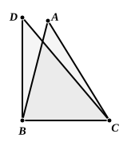

Next, by joining $BG$, $CH$, we prove in like manner that the rectangles ">$AR$, ">$AQ$ are equal.

Now the square on $BC$ is equal to the sum of the rectangles ">$BP$, ">$CP$,

i.e. to the sum of the rectangles ">$BR$, ">$CQ$,

i.e. to the sum of the squares ">$BH$, ">$CG$ diminished by the rectangles ">$AR$, ">$AQ$.

But the rectangles ">$AR$, ">$AQ$ are equal, and they are respectively the rectangles contained by $BA$, $AN$ and by $CA$, $AM$.

Therefore the square on $BC$ is less than the squares on $BA$, $AC$ by twice the rectangle $BA$, $AN$ or $CA$, $AM$.

Next suppose that we have to prove the theorem in the case where the triangle has an obtuse angle at $A$.

Take $B$ as the acute angle under consideration, so that $AC$ is the side opposite to it.

Now the square on $CA$ is equal to the difference of the rectangles ">$CQ$, ">$AQ$,

i.e. to the difference between ">$CP$ and ">$AQ$,

i.e. to the difference between the square ">$BE$ and the sum of the rectangles ">$BP$, ">$AQ$,

i.e. to the difference between the square ">$BE$ and the sum of the rectangles ">$BP$, ">$AR$,

i.e. to the difference between the sum of the squares ">$BE$, ">$BH$ and the sum of the rectangles ">$BP$, ">$BR$

(since ">$AR$ is the difference between ">$BR$ and ">$BH$).

But ">$BP$, ">$BR$ are equal, and they are respectively the rectangles $CB$, $BL$ and $AB$, $BN$.

Therefore the square on $CA$ is less than the squares on $AB$, $BC$ by twice the rectangle $CB$, $BL$ or $AB$, $BN$.

Heron's proof of his converse proposition (an-Nairīzī, ed. Curtze, p. 110), which is also given by the Greek scholiast above quoted, is of course simple. For let ">$ABC$ be a triangle in which the square on $AC$ is less than the squares on $AB$, $BC$.

Draw $BD$ at right angles to $BC$ and of length equal to $BA$.

Join $DC$.

Then, since the angle $CBD$ is right,
the square on $DC$ is equal to the squares on $DB$, $BC$,
i.e. to the squares on $AB$, $BC$. [I. 47]

But the square on $AC$ is less than the squares on $AB$, $BC$.

Therefore the square on $AC$ is less than the square on $DC$.

Therefore $AC$ is less than $DC$.

Hence in the two triangles ">$DBC$, ">$ABC$ the sides about the angles $DBC$, $ABC$ are respectively equal, but the base $DC$ is greater than the base $AC$.
