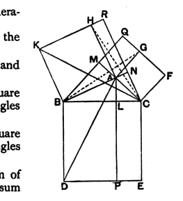
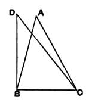

Next, by joining $BG, CH$, we prove in like manner that the rectangles $AR, AQ$ are equal.

Now the square on $BC$ is equal to the sum of the rectangles $BP, CP$,

i.e. to the sum of the rectangles $BR, CQ$,

i.e. to the sum of the squares $BH, CG$ diminished by the rectangles $AR, AQ$.

But the rectangles $AR, AQ$ are equal, and they are respectively the rectangles contained by $BA, AN$ and by $CA, AM$.

Therefore the square on $BC$ is less than the squares on $BA, AC$ by twice the rectangle $BA, AN$ or $CA, AM$.

Next suppose that we have to prove the theorem in the case where the triangle has an obtuse angle at $A$.

Take $B$ as the acute angle under consideration, so that $AC$ is the side opposite to it.

Now the square on $CA$ is equal to the difference of the rectangles $CQ, AQ$,

i.e. to the difference between $CP$ and $AQ$,

i.e. to the difference between the square $BE$ and the sum of the rectangles $BP, AQ$,

i.e. to the difference between the square $BE$ and the sum of the rectangles $BP, AR$,

i.e. to the difference between the sum of the squares $BE, BH$ and the sum of the rectangles $BP, BR$

(since $AR$ is the difference between $BR$ and $BH$).

But $BP, BR$ are equal, and they are respectively the rectangles $CB, BL$ and $AB, BN$.

Therefore the square on $CA$ is less than the squares on $AB, BC$ by twice the rectangle $CB, BL$ or $AB, BN$.

Heron's proof of his converse proposition (an-Nairīzī, ed. Curtze, p. 110), which is also given by the Greek scholiast above quoted, is of course simple. For let $ABC$ be a triangle in which the square on $AC$ is less than the squares on $AB, BC$.

Draw $BD$ at right angles to $BC$ and of length equal to $BA$.

Join $DC$.

Then, since the angle $CBD$ is right,
the square on $DC$ is equal to the squares on $DB, BC$,
i.e. to the squares on $AB, BC$. [I. 47]

But the square on $AC$ is less than the squares on $AB, BC$.

Therefore the square on $AC$ is less than the square on $DC$.

Therefore $AC$ is less than $DC$.

Hence in the two triangles $DBC, ABC$ the sides about the angles $DBC, ABC$ are respectively equal, but the base $DC$ is greater than the base $AC$.
