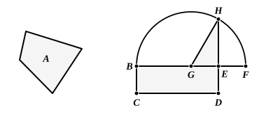

Therefore the angle $DBC$ (a right angle) is greater than the angle $ABC$ [I. 25], which latter is therefore *acute*.

It may be noted, lastly, that II. 12, 13 are supplementary to I. 47 and complete the theory of the relations between the squares on the sides of *any* triangle, whether right-angled or not.

---

### PROPOSITION 14.

To construct a square equal to a given rectilineal figure.

Let $A$ be the given rectilineal figure;  
thus it is required to construct a square equal to the rectilineal figure $A$.

5 For let there be constructed the rectangular parallelogram ">$BD$ equal to the rectilineal figure $A$. [I. 45]

Then, if $BE$ is equal to $ED$, that which was enjoined will have been done; for a square ">$BD$ has been constructed equal to the rectilineal figure $A$.

10 But, if not, one of the straight lines $BE$, $ED$ is greater.  
Let $BE$ be greater, and let it be produced to $F$;  
let $EF$ be made equal to $ED$, and let $BF$ be bisected at $G$.

With centre $G$ and distance one of the straight lines $GB$, $GF$ let the semicircle $BHF$ be described; let $DE$ be produced 15 to $H$, and let $GH$ be joined.

Then, since the straight line $BF$ has been cut into equal segments at $G$, and into unequal segments at $E$,  

the rectangle contained by $BE$, $EF$ together with the square on $EG$ is equal to the square on $GF$. [II. 5]

20 But $GF$ is equal to $GH$;  

therefore the rectangle $BE$, $EF$ together with the square on $GE$ is equal to the square on $GH$.

But the squares on $HE$, $EG$ are equal to the square on $GH$; [I. 47]  
25 
therefore the rectangle $BE$, $EF$ together with the square on $GE$ is equal to the squares on $HE$, $EG$.

Let the square on $GE$ be subtracted from each;
