and proved only the fact that that which is sought really exists, but did not produce it[^1] and were accordingly confuted by the definition and the whole doctrine. They based their definition on an incidental characteristic, thus: A porism is that which falls short of a locus-theorem in respect of its hypothesis[^2]. Of this kind of porisms loci are a species, and they abound in the *Treasury of Analysis*; but this species has been collected, named and handed down separately from the porisms, because it is more widely diffused than the other species]. But it has further become characteristic of porisms that, owing to their complication, the enunciations are put in a contracted form, much being by usage left to be understood; so that many geometers understand them only in a partial way and are ignorant of the more essential features of their contents.

"[Now to comprehend a number of propositions in one enunciation is by no means easy in these porisms, because Euclid himself has not in fact given many of each species, but chosen, for examples, one or a few out of a great multitude[^3]. But at the beginning of the first book he has given some propositions, to the number of ten, of one species, namely that more fruitful species consisting of loci.] Consequently, finding that these admitted of being comprehended in one enunciation, we have set it out thus:

> **If, in a system of four straight lines[^4] which cut each other two and two, three points on one straight line be given while the rest except one lie on different straight lines given in position, the remaining point also will lie on a straight line given in position[^5].**

[^1]: Heiberg points out that Props. 5–9 of Archimedes' treatise *On Spirals* are porisms in this sense. To take Prop. 5 as an example, *DBF* is a tangent to a circle with centre *K*. It is then possible, says Archimedes, to draw a straight line *KHF*, meeting the circumference in *H* and the tangent in *F*, such that  
$FH : HK < (\text{arc } BH) : c$,  
where $c$ is the circumference of any circle. To prove this he assumes the following construction. $E$ being any straight line greater than $c$, he says: let $KG$ be parallel to *DF*, "and let the line *GH* equal to $E$ be placed *verging to the point B*." Archimedes must of course have known how to *effect* this construction, which requires conics. But that it is *possible* requires very little argument, for if we draw any straight line *BHG* meeting the circle in *H* and *KG* in *G*, it is obvious that as *G* moves away from *C*, *HG* becomes greater and greater and may be made as great as we please. The "later writers" would no doubt have contented themselves with this consideration without actually *constructing HG*.  

[^2]: As Heiberg says, this translation is made certain by a preceding passage of Pappus (p. 648, 1—3) where he compares two enunciations, the latter of which "falls short of the former *in hypothesis* but goes *beyond it in requirement*." E.g. the first enunciation requiring us, given three circles, to draw a circle touching all three, the second may require us, given only *two* circles (one less datum), to draw a circle touching them and *of a given size* (an extra requirement).

[^3]: I translate Heiberg's reading with a full stop here followed by πρὸς ἀρχῇ δὲ ὅμως [πρὸς ἀρχὴν (δεδομένον) Hultsch] τοῦ πρώτου βιβλίου....

[^4]: The four straight lines are described in the text as (the sides) ὑπτίου ἢ παρυπτίου, i.e. sides of two sorts of quadrilaterals which Simson tries to explain (see p. 120 of the *Index Graecitatis* of Hultsch's edition of Pappus).

[^5]: In other words (Chasles, p. 23; Loria, p. 256), if a triangle be so deformed that each of its sides turns about one of three points in a straight line, and two of its vertices lie on two straight lines given in position, the third vertex will also lie on a straight line.
