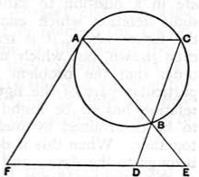

Therefore the rectangle $AE, EB$ is equal to the rectangle $FE, ED$.

(Part II. *Resolution*.)

But the rectangle $AE, EB$ is given, because it is equal to the square on the tangent from $E$.

Therefore the rectangle $FE, ED$ is given; and, since $ED$ is given, $FE$ is given (in length). [*Data*, 57.]

But $FE$ is given in position also, so that $F$ is also given. [*Data*, 27.]

Now $FA$ is the tangent from a given point $F$ to a circle $ABC$ given in position; therefore $FA$ is given in position and magnitude. [*Data*, 90.]

And $F$ is given; therefore $A$ is given.

But $E$ is also given; therefore the straight line $AE$ is given in position. [*Data*, 26.]

And the circle $ABC$ is given in position; therefore the point $B$ is also given. [*Data*, 25.]

But the points $D, E$ are also given; therefore the straight lines $DB, BE$ are also given in position.

**Synthesis.**

(Part I. *Construction*.)

Suppose the circle $ABC$ and the points $D, E$ given.

Take a rectangle contained by $ED$ and by a certain straight line $EF$ equal to the square on the tangent to the circle from $E$.

From $F$ draw $FA$ touching the circle in $A$; join $ABE$ and then $DB$, producing $DB$ to meet the circle at $C$. Join $AC$.

I say then that $AC$ is parallel to $DE$.

(Part II. *Demonstration*.)

Since, by hypothesis, the rectangle $FE, ED$ is equal to the square on the tangent from $E$, which again is equal to the rectangle $AE, EB$, the rectangle $AE, EB$ is equal to the rectangle $FE, ED$.

Therefore $A, B, D, F$ are concyclic, whence the angle $FAE$ is equal to the angle $BDE$.

But the angle $FAE$ is equal to the angle $ACB$ in the alternate segment; therefore the angle $ACB$ is equal to the angle $BDE$.

Therefore $AC$ is parallel to $DE$.

In cases where a διορισμός is necessary, i.e. where a solution is only possible under certain conditions, the analysis will enable those conditions to be ascertained. Sometimes the διορισμός is stated and proved at the end of the analysis, e.g. in Archimedes, *On the Sphere and Cylinder*, II. 7; sometimes it is stated in that place and the proof postponed till after the end of the synthesis, e.g. in the solution of the problem subsidiary to *On the Sphere and Cylinder*, II. 4, preserved in Eutocius’ commentary on that proposition. The analysis should also enable us to determine the number of solutions of which the problem is susceptible.
