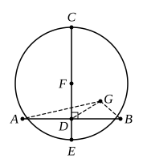

# BOOK III. PROPOSITIONS.

## PROPOSITION 1.

*To find the centre of a given circle.*

Let $ABC$ be the given circle;
thus it is required to find the centre of the circle $ABC$.

Let a straight line $AB$ be drawn
5 through it at random, and let it be bisected
at the point $D$;
from $D$ let $DC$ be drawn at right angles
to $AB$ and let it be drawn through to $E$;
let $CE$ be bisected at $F$;
10 I say that $F$ is the centre of the circle
$ABC$.

For suppose it is not,[^7_1] but, if possible,
let $G$ be the centre,
and let $GA$, $GD$, $GB$ be joined.

15 Then, since $AD$ is equal to $DB$,
and $DG$ is common,
the two sides $AD$, $DG$ are equal to the two sides
$BD$, $DG$ respectively;[^7_2]
and the base $GA$ is equal to the base $GB$, for they are
20 radii;
therefore the angle $ADG$ is equal to the angle $GDB$. [I. 8]

But, when a straight line set up on a straight line makes
the adjacent angles equal to one another, each of the equal
angles is right; [I. Def. 10]
25 therefore the angle $GDB$ is right.
