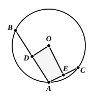

But the angle $FDB$ is also right;
therefore the angle $FDB$ is equal to the angle $GDB$, the
greater to the less: which is impossible.

Therefore $G$ is not the centre of the circle $ABC$.

30 Similarly we can prove that neither is any other point
except $F$.

Therefore the point $F$ is the centre of the circle $ABC$.

PORISM. From this it is manifest that, if in a circle a
straight line cut a straight line into two equal parts and at
35 right angles, the centre of the circle is on the cutting straight
line.

Q. E. F.

---

**12. For suppose it is not.** This is expressed in the Greek by the two words Μὴ γάρ, but such an elliptical phrase is impossible in English.

[^7_2]: 17. **the two sides AD, DG are equal to the two sides BD, DG respectively.** As before observed, Euclid is not always careful to put the equals in corresponding order. The text here has "$GD$, $DB$."

Todhunter observes that, when, in the construction, $DC$ is said to be *produced* to $E$, it is assumed that $D$ is within the circle, a fact which Euclid first demonstrates in III. 2. This is no doubt true, although the word διήχθω, "let it be *drawn through*," is used instead of ἐκβεβλήσθω, "let it be *produced*." And, although it is not necessary to assume that $D$ is within the circle, it is necessary for the success of the construction that the straight line drawn through $D$ at right angles to $AB$ shall meet the circle in two points (and no more): an assumption which we are not entitled to make on the basis of what has gone before only.

Hence there is much to be said for the alternative procedure recommended by De Morgan as preferable to that of Euclid. De Morgan would first prove the fundamental theorem that "the line which bisects a chord perpendicularly must contain the centre," and then make III. 1, III. 25 and IV. 5 immediate corollaries of it. The fundamental theorem is a direct consequence of the theorem that, if $P$ is *any* point equidistant from $A$ and $B$, then $P$ lies on the straight line bisecting $AB$ perpendicularly. We then take any two chords $AB$, $AC$ of the given circle and draw $DO$, $EO$ bisecting them perpendicularly. Unless $BA$, $AC$ are in one straight line, the straight lines $DO$, $EO$ must meet in some point $O$ (see note on IV. 5 for possible methods of proving this). And, since both $DO$, $EO$ must contain the centre, $O$ must be the centre.

This method, which seems now to be generally preferred to Euclid's, has the advantage of showing that, in order to find the centre of a circle, it is sufficient to know three points on the circumference. If therefore two circles have three points in common, they must have the same centre and radius, so that two circles cannot have three points in common without coinciding entirely. Also, as indicated by De Morgan, the same construction enables us (1) to draw the complete circle of which a segment or arc only is given (III. 25), and (2) to circumscribe a circle to any triangle (IV. 5).
