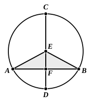

given point to a given straight line, and of others that which is nearer to the perpendicular is less than the more remote, and the converse; also not more than two equal straight lines can be drawn from the point to the line, one on each side of the perpendicular."

The fact that not more than two equal straight lines can be drawn from a given point to a given straight line not passing through it is proved by Proclus on I. 16 (see the note to that proposition) and can alternatively be proved by means of I. 7, as shown above in the note on I. 12. It follows that

<em>A straight line cannot cut a circle in more than two points</em>

a proposition which De Morgan would introduce here after III. 2. The proof given does not apply to a straight line *passing through the centre*; but that such a line only cuts the circle in two points is self-evident.

---

### PROPOSITION 3.

If in a circle a straight line through the centre bisect a 
straight line not through the centre, it also cuts it at right 
angles; and if it cut it at right angles, it also bisects it.

Let $ABC$ be a circle, and in it let a straight line $CD$  
5 through the centre bisect a straight line  
$AB$ not through the centre at the point  
$F$;  
I say that it also cuts it at right angles.

For let the centre of the circle $ABC$  
10 be taken, and let it be $E$; let $EA$, $EB$  
be joined.

Then, since $AF$ is equal to $FB$,  
and $FE$ is common,  

two sides are equal to two sides;

15 and the base $EA$ is equal to the base $EB$;  

therefore the angle $AFE$ is equal to the angle $BFE$. [I. 8]

But, when a straight line set up on a straight line makes  
the adjacent angles equal to one another, each of the equal  
angles is right; [I. Def. 10]  

20 therefore each of the angles $AFE$, $BFE$ is right.

Therefore $CD$, which is through the centre, and bisects 
$AB$ which is not through the centre, also cuts it at right 
angles.

Again, let $CD$ cut $AB$ at right angles;  
25 I say that it also bisects it, that is, that $AF$ is equal to $FB$.
