For, with the same construction,[^11_1]
since $EA$ is equal to $EB$,
the angle $EAF$ is also equal to the angle $EBF$. [I. 5]
But the right angle $AFE$ is equal to the right angle $BFE$,
30 therefore $EAF$, $EBF$ are two triangles having two angles
equal to two angles and one side equal to one side, namely
$EF$, which is common to them, and subtends one of the equal
angles;
therefore they will also have the remaining sides equal to
35 the remaining sides; [I. 26]
therefore $AF$ is equal to $FB$.

Therefore etc.

Q. E. D.

---

[^11_1]: 26. **with the same construction**, τῶν αὐτῶν κατασκευασθέντων.

This proposition asserts the two *partial* converses (cf. note on I. 6) of the Porism to III. 1. De Morgan would place it next to III. 1.

---

## PROPOSITION 4.

*If in a circle two straight lines cut one another which are not through the centre, they do not bisect one another.*

Let $ABCD$ be a circle, and in it let the two straight lines
$AC$, $BD$, which are not through the
centre, cut one another at $E$;
I say that they do not bisect one
another.

For, if possible, let them bisect one
another, so that $AE$ is equal to $EC$,
and $BE$ to $ED$;
let the centre of the circle $ABCD$ be
taken [III. 1], and let it be $F$; let $FE$ be
joined.

Then, since a straight line $FE$ through the centre bisects
a straight line $AC$ not through the centre,
it also cuts it at right angles; [III. 3]
therefore the angle $FEA$ is right.

Again, since a straight line $FE$ bisects a straight line $BD$,
it also cuts it at right angles; [III. 3]
therefore the angle $FEB$ is right.
