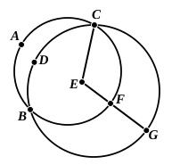

But the angle $FEA$ was also proved right;  
therefore the angle $FEA$ is equal to the angle $FEB$, the less to the greater: which is impossible.  

Therefore $AC$, $BD$ do not bisect one another.

Therefore etc. Q. E. D.

---

### PROPOSITION 5.

If two circles cut one another, they will not have the same 
centre.

For let the circles $ABC$, $CDG$ cut one another at the points $B$, $C$;  
I say that they will not have the same centre.

For, if possible, let it be $E$; let $EC$ be joined, and let $EFG$ be drawn through at random.

Then, since the point $E$ is the centre of the circle $ABC$,  

$EC$ is equal to $EF$. [I. Def. 15]

Again, since the point $E$ is the centre of the circle $CDG$,  

$EC$ is equal to $EG$.

But $EC$ was proved equal to $EF$ also;  
therefore $EF$ is also equal to $EG$, the less to the greater: which is impossible.  

Therefore the point $E$ is not the centre of the circles 
$ABC$, $CDG$.

Therefore etc. Q. E. D.

---

The propositions III. 5, 6 could be combined in one. It makes no difference whether the circles cut, or meet without cutting, so long as they do not coincide altogether; in either case they cannot have the same centre. The two cases are covered by the enunciation: *If the circumferences of two circles meet at a point they cannot have the same centre.* On the other hand, *If two circles have the same centre and one point in their circumferences common, they must coincide altogether.*
