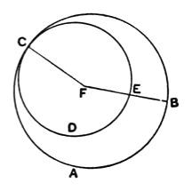

## PROPOSITION 6.

*If two circles touch one another, they will not have the same centre.*

For let the two circles $ABC$, $CDE$ touch one another at the point $C$;
I say that they will not have the same centre.

For, if possible, let it be $F$; let $FC$ be joined, and let $FEB$ be drawn through at random.

Then, since the point $F$ is the centre of the circle $ABC$,
$$FC \text{ is equal to } FB.$$

Again, since the point $F$ is the centre of the circle $CDE$,
$$FC \text{ is equal to } FE.$$

But $FC$ was proved equal to $FB$;
therefore $FE$ is also equal to $FB$, the less to the greater: which is impossible.

Therefore $F$ is not the centre of the circles $ABC$, $CDE$.

Therefore etc.

Q. E. D.

---

The English editions enunciate this proposition of circles touching *internally*, but the word (ἐντός) is a mere interpolation, which was no doubt made because Euclid's figure showed only the case of *internal* contact. The fact is that, in his usual manner, he chose for demonstration the more difficult case, and left the other case (that of *external* contact) to the intelligence of the reader. It is indeed sufficiently self-evident that circles touching externally cannot have the same centre; but Euclid's proof can really be used for this case too.

Camerer remarks that the proof of III. 6 seems to assume tacitly that the points $E$ and $B$ cannot coincide, or that circles which touch internally at $C$ cannot meet in any other point, whereas this fact is not proved by Euclid till III. 13. But no such general assumption is necessary here; it is only necessary that *one* line drawn from the assumed common centre should meet the circles in different points; and the very notion of internal contact requires that, before one circle *meets* the other on its inner side, it must have passed through points *within* the latter circle.
