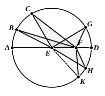

### PROPOSITION 7.

If on the diameter of a circle a point be taken which is not 
the centre of the circle, and from the point straight lines fall 
upon the circle, that will be greatest on which the centre is, the 
remainder of the same diameter will be least, and of the rest 
5 the nearer to the straight line through the centre is always 
greater than the more remote, and only two equal straight 
lines will fall from the point on the circle, one on each side 
of the least straight line.

Let $ABCD$ be a circle, and let $AD$ be a diameter of it;  
10 on $AD$ let a point $F$ be taken which is not the centre of the  
circle, let $E$ be the centre of the circle,  
and from $F$ let straight lines $FB$, $FC$, $FG$ fall upon the circle  
$ABCD$;  
I say that $FA$ is greatest, $FD$ is least, and of the rest $FB$ is  
15 greater than $FC$, and $FC$ than $FG$.

For let $BE$, $CE$, $GE$ be joined.  
Then, since in any triangle two  
sides are greater than the remaining  
one, [I. 20]  

20 $EB$, $EF$ are greater than $BF$.

But $AE$ is equal to $BE$;  

therefore $AF$ is greater than $BF$.

Again, since $BE$ is equal to $CE$,  
and $FE$ is common,  
25 the two sides $BE$, $EF$ are equal to the two sides $CE$, $EF$.  
But the angle $BEF$ is also greater than the angle $CEF$;  

therefore the base $BF$ is greater than the base $CF$. [I. 24]

For the same reason  

$CF$ is also greater than $FG$.

30 Again, since $GF$, $FE$ are greater than $EG$,  
and $EG$ is equal to $ED$,  

$GF$, $FE$ are greater than $ED$.

Let $EF$ be subtracted from each;  

therefore the remainder $GF$ is greater than the remainder 
35 $FD$.

Therefore $FA$ is greatest, $FD$ is least, and $FB$ is greater 
than $FC$, and $FC$ than $FG$.

