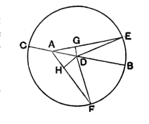

Hence the point $B$ in which $FB$ meets the circle is further from the foot of the perpendicular from $E$ on $FB$ than $M$ is;
therefore the angle $BEF$ is greater than the angle $CEF$.

Another way of enunciating the first part of the proposition is that of Mr H. M. Taylor, viz. "Of all straight lines drawn to a circle from an internal point not the centre, the one which passes through the centre is the greatest, and the one which when produced passes through the centre is the least; and of any two others the one which *subtends the greater angle at the centre* is the greater." The substitution of the *angle subtended at the centre* as the criterion no doubt has the effect of avoiding the necessity of dealing with the unproved assumption in Euclid's proof referred to above, and the similar substitution in the enunciation of the first part of III. 8 has the effect of avoiding the necessity for dealing with like unproved assumptions in Euclid's proof, as well as the complication caused by the distinction in Euclid's enunciation between lines falling from an external point on the *convex circumference* and on the *concave circumference* of a circle respectively, terms which are not defined but taken as understood.

Mr Nixon (*Euclid Revised*) similarly substitutes as the criterion the angle subtended at the centre, but gives as his reason that the words "nearer" and "more remote" in Euclid's enunciation are scarcely clear enough without some definition of the sense in which they are used. Smith and Bryant make the substitution in III. 8, but follow Euclid in III. 7.

On the whole, I think that Euclid's plan of taking straight lines drawn from the point which is not the centre direct to the circumference and making greater or less angles *at that point* with the straight line containing it and the centre is the more instructive and useful of the two, since it is such lines drawn in any manner to the circle from the point which are immediately useful in the proofs of later propositions or in resolving difficulties connected with those proofs.

Heron again (an-Nairīzī, ed. Curtze, pp. 114—5) has a note on this proposition which is curious. He first of all says that Euclid proves that lines *nearer the centre* are greater than those more remote *from it*. This is a different view of the question from that taken in Euclid's proposition as we have it, in which the lines are not nearer to and more remote from the *centre* but from *the line through the centre*. Euclid takes lines inclined to the latter line at a greater or less angle; Heron introduces distance *from the centre* in the sense of Deff. 4, 5, i.e. in the sense of *the length of the perpendicular* drawn to the line from the centre, which Euclid does not use till III. 14, 15. Heron then observes that in Euclid's proposition the lines compared are all drawn on one side of the line through the centre, and sets himself to prove the same truth of lines on *opposite* sides which are more or less distant *from the centre*. The new point of view necessitates a quite different line of proof, anticipating the methods of later propositions.

The first case taken by Heron is that of two straight lines such that the perpendiculars from the centre on them fall on the lines themselves and not in either case on the line produced.

Let $A$ be the given point, $D$ the centre, and let $AE$ be nearer the centre than $AF$, so that the perpendicular $DG$ on $AE$ is less than the perpendicular $DH$ on $AF$.

$$\begin{aligned}
\text{Then} \quad \text{sqs. on } DG, GE &= \text{sqs. on } DH, HF, \\
\text{and} \quad \text{sqs. on } DG, GA &= \text{sqs. on } DH, HA. \\
\text{But} \quad \text{sq. on } DG &< \text{sq. on } DH.
\end{aligned}$$
