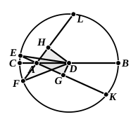

Therefore sq. on $GE$ $>$ sq. on $HF$,

and sq. on $GA$ $>$ sq. on $HA$,

whence $GE$ $>$ $HF$,

$GA$ $>$ $HA$.

Therefore, by addition, $AE$ $>$ $AF$.

The other case taken by Heron is that where one perpendicular falls on the line produced, as in the annexed figure. In this case we prove in like manner that

$GE$ $>$ $HF$,

and $GA$ $>$ $AH$.

Thus $AE$ is greater than the sum of $HF$, $AH$, whence, *a fortiori*, $AE$ is greater than the difference of $HF$, $AH$, i.e. than $AF$.

Heron does not give the third possible case, that, namely, where *both* perpendiculars fall on the lines produced. The fact is that, in this case, the foregoing method breaks down. Though $AE$ be nearer to the centre than $AF$ in the sense that $DG$ is less than $DH$,

$AE$ is not greater but <em>less</em> than $AF$.

Moreover this cannot be proved by the same method as before.
For, while we can prove that

$GE$ $>$ $HF$,

$GA$ $>$ $AH$,

we cannot make any inference as to the comparative length of $AE$, $AF$.

To judge by Heron's corresponding note to III. 8, he would, to prove this case, practically prove III. 35 first, i.e. prove that, if $EA$ be produced to $K$ and $FA$ to $L$,

rect. $FA$, $AL$ $=$ rect. $EA$, $AK$,

from which he would infer that, since $AK$ $>$ $AL$ by the first case,

$AE$ $<$ $AF$.

An excellent moral can, I think, be drawn from the note of Heron. Having the appearance of supplementing, or giving an alternative for, Euclid's proposition, it cannot be said to do more than confuse the subject. Nor was it necessary to find a new proof for the case where the two lines which are compared are on *opposite* sides of the diameter, since Euclid shows that for each line from the point to the circumference on one side of the diameter there is another of the same length equally inclined to it on the other side.

---

## PROPOSITION 8.

*If a point be taken outside a circle and from the point straight lines be drawn through to the circle, one of which is through the centre and the others are drawn at random, then, of the straight lines which fall on the concave circumference, that through the centre is greatest, while of the rest*
