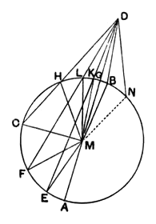

*the nearer to that through the centre is always greater than the more remote, but, of the straight lines falling on the convex circumference, that between the point and the diameter is least, while of the rest the nearer to the least is always less than the more remote, and only two equal straight lines will fall on the circle from the point, one on each side of the least.*

Let $ABC$ be a circle, and let a point $D$ be taken outside $ABC$; let there be drawn through from it straight lines $DA$, $DE$, $DF$, $DC$, and let $DA$ be through the centre;
I say that, of the straight lines falling on the concave circumference $AEFC$, the straight line $DA$ through the centre is greatest,
while $DE$ is greater than $DF$ and $DF$ than $DC$;
but, of the straight lines falling on the convex circumference $HLKG$, the straight line $DG$ between the point and the diameter $AG$ is least; and the nearer to the least $DG$ is always less than the more remote, namely $DK$ than $DL$, and $DL$ than $DH$.

For let the centre of the circle $ABC$ be taken [III. 1], and let it be $M$; let $ME$, $MF$, $MC$, $MK$, $ML$, $MH$ be joined.

Then, since $AM$ is equal to $EM$,
let $MD$ be added to each;
therefore $AD$ is equal to $EM$, $MD$.
But $EM$, $MD$ are greater than $ED$; [I. 20]
therefore $AD$ is also greater than $ED$.

Again, since $ME$ is equal to $MF$,
and $MD$ is common,
therefore $EM$, $MD$ are equal to $FM$, $MD$;
and the angle $EMD$ is greater than the angle $FMD$;
therefore the base $ED$ is greater than the base $FD$. [I. 24]

Similarly we can prove that $FD$ is greater than $CD$;
therefore $DA$ is greatest, while $DE$ is greater than $DF$, and $DF$ than $DC$.
