As De Morgan points out, there are here two assumptions similar to that tacitly made in the proof of III. 7, namely that $K$ falls within the triangle ">$DLM$ and $E$ outside the triangle ">$DFM$. These facts can be proved in the same way as the assumption in III. 7. Let $DE$ meet $FM$ in $Y$ and $LM$ in $Z$. Then, as before, $MZ$ is less than $ML$ and therefore than $MK$. Therefore $K$ lies further than $Z$ from the foot of the perpendicular from $M$ on $DE$. Similarly $E$ lies further than $Y$ from the foot of the same perpendicular.

Heron deals with lines on *opposite* sides of the diameter through the external point in a manner similar to that adopted in his previous note.
For the case where $E$, $F$ are the *second* points in which $AE$, $AF$ meet the circle the method answers well enough.
If $AE$ is nearer the centre $D$ than $AF$ is,

sqs. on $DG$, $GE$ $=$ sqs. on $DH$, $HF$

and

sqs. on $DG$, $GA$ $=$ sqs. on $DH$, $HA$,

whence, since $DG$ $<$ $DH$,
it follows that $GE$ $>$ $HF$,
and $AG$ $>$ $AH$,
so that, by addition, $AE$ $>$ $AF$.

But, if $K$, $L$ be the points in which $AE$, $AF$ *first* meet the circle, the method fails, and Heron is reduced to proving, in the first instance, the property usually deduced from III. 36. He argues thus:
$AKD$ being an obtuse angle,

sq. on $AD$ $=$ sum of sqs. on $AK$, $KD$ and twice rect. $AK$, $KG$. [II. 12]

$ALD$ is also an obtuse angle, and it follows that

sum of sqs. on $AK$, $KD$ and twice rect. $AK$, $KG$ is equal to

sum of sqs. on $AL$, $LD$ and twice rect. $AL$, $LH$.

Therefore, the squares on $KD$, $LD$ being equal,

sq. on $AK$ and twice rect. $AK$, $KG$ $=$ sq. on $AL$ and twice rect. $AL$, $LH$,

or

sq. on $AK$ and rect. $AK$, $KE$ $=$ sq. on $AL$ and rect. $AL$, $LF$,

i.e.

rect. $AK$, $AE$ $=$ rect. $AL$, $AF$.

But, by the first part, $AE$ $>$ $AF$.
Therefore $AK$ $<$ $AL$.

III. 7, 8 deal with the lengths of the several lines drawn to the circumference of a circle (1) from a point within it, (2) from a point outside it; but a similar proposition is true of straight lines drawn from a point on the circumference itself: *If any point be taken on the circumference of a circle, then, of all the straight lines which can be drawn from it to the circumference, the greatest is that in which the centre is; of any others that which is nearer to the straight line which passes through the centre is greater than one more remote; and from the same point there can be drawn to the circumference two straight lines, and only two, which are equal to one another, one on each side of the greatest line.*
