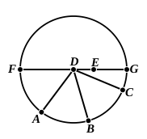

For the same reason  

the centre of the circle $ABC$ is also on $HL$.

And the straight lines $GK$, $HL$ have no other point common but the point $D$;  

therefore the point $D$ is the centre of the circle $ABC$.

Therefore etc. Q. E. D.

---

The result of this proposition is quoted by Aristotle, $Meteorologica$ III. 3, 373 a 13—16 (cf. note on I. 8).

III. 9 is, as De Morgan remarks, a *logical* equivalent of part of III. 7, where it is proved that every *non*-central point is *not* a point from which three equal straight lines can be drawn to the circle. Thus III. 7 says that every *not*-$A$ is *not*-$B$, and III. 9 states the equivalent fact that every $B$ is $A$. Mr H. M. Taylor does in effect make a *logical* inference of the theorem that, *If from a point three equal straight lines can be drawn to a circle, that point is the centre*, by making it a corollary to his proposition which includes the part of III. 7 referred to. Euclid does not allow himself these logical inferences, as we shall have occasion to observe elsewhere also.

Of the two proofs of this proposition given in earlier texts of Euclid, August and Heiberg regard that translated above as genuine, relegating the other, which Simson gave alone, to a place in an Appendix. Camerer remarks that the genuine proof should also have contemplated the case in which one or other of the straight lines $AB$, $BC$ passes through $D$. This would however have been a departure from Euclid's manner of taking the most obscure case for proof and leaving others to the reader.

The other proof, that selected by Simson, is as follows:  
"For let a point $D$ be taken within the circle $ABC$, and from $D$ let more than two equal straight lines, namely $AD$, $DB$, $DC$, fall on the circle $ABC$;  
I say that the point $D$ so taken is the centre of the circle $ABC$.

For suppose it is not; but, if possible, let it be $E$, and let $DE$ be joined and carried through to the points $F$, $G$.  
Therefore $FG$ is a diameter of the circle $ABC$.  
Since, then, on the diameter $FG$ of the circle $ABC$ a point has been taken which is not the centre of the circle, namely $D$,  

$DG$ is greatest, and $DC$ is greater than $DB$, and $DB$ than $DA$.

But the latter are also equal: which is impossible.  

Therefore $E$ is not the centre of the circle.

Similarly we can prove that neither is any other point except $D$;  

therefore the point $D$ is the centre of the circle $ABC$.

Q. $E$. D."

On this Todhunter correctly points out that the point $E$ might be supposed to fall *within* the angle $ADC$. It cannot then be shown that $DC$ is greater than $DB$ and $DB$ than $DA$, but only that either $DC$ or $DA$ is less than $DB$; this however is sufficient for establishing the proposition.
