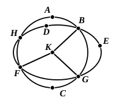

Since then a point $K$ has been taken within the circle $DEF$,
and from $K$ more than two straight lines, namely
$KB$, $KF$, $KG$, have fallen on the circle $DEF$,
the point $K$ is the centre of the circle $DEF$. [III. 9]

But $K$ is also the centre of the circle $ABC$.

Therefore two circles cutting one another have
the same centre $K$: which is impossible. [III. 5]

Therefore a circle does not cut a circle at more
points than two.

Q. E. D."

This demonstration is claimed by Heron (see an-Nairīzī, ed. Curtze, pp. 120—1). It is incomplete because it assumes that the point $K$ which is taken as the centre of the circle $ABC$ is *within* the circle $DEF$. It can however be completed by means of III. 8 and the corresponding proposition with reference to a point *on* the circumference of a circle which was enunciated in the note on III. 8. For (1) if the point $K$ is *on* the circumference of the circle $DEF$, we obtain a contradiction of the latter proposition which asserts that only *two* equal straight lines can be drawn from $K$ to the circumference of the circle $DEF$; (2) if the point $K$ is *outside* the circle $DEF$, we obtain a contradiction of the corresponding part of III. 8.

Euclid's proof contains an unproved assumption, namely that the lines bisecting $BG$, $BH$ at right angles *will* meet in a point $P$. For a discussion of this assumption see note on IV. 5.

---

### PROPOSITION 11.

*If two circles touch one another internally, and their centres be taken, the straight line joining their centres[^25_2], if it be also produced, will fall on the point of contact[^25_3] of the circles.*

For let the two circles $ABC$, $ADE$ touch one another internally at the point $A$, and let the centre $F$ of the circle $ABC$, and the centre $G$ of $ADE$, be taken;

I say that the straight line joined from $G$ to $F$ and produced will fall on $A$.

For suppose it does not, but, if possible, let it fall as $FGH$, and let $AF$, $AG$ be joined.

Then, since $AG$, $GF$ are greater than $FA$, that is, than $FH$,
let $FG$ be subtracted from each;
therefore the remainder $AG$ is greater than the remainder $GH$.
