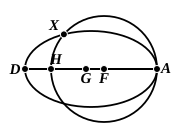

(*b*) $A$ may lie outside the line $FG$ altogether, in which case $FG$ produced beyond $G$ must, in consequence of result 2 above, either

(i) meet the circles in a point common to both, or

(ii) meet the circles in two points, of which that which is on the inner circle is nearer to $G$ than the other is.

(*a*) is then proved to be impossible by means of the fact that the radius of the inner circle is less than the radius of the outer.

(*b*) (ii) is Euclid's case; and his proof holds equally of (*b*) (i), the hypothesis, namely, that $D$ and $H$ in the figure coincide.

Thus all alternative hypotheses are successively shown to be impossible, and the proposition is completely established.

I think, however, that this procedure may be somewhat shortened in the following manner.

In order to make Euclid's proof absolutely conclusive we have only (1) to take care to produce $FG$ beyond $G$, the centre of the "inner" circle, and then (2) to prove that the point in which $FG$ so produced meets the "inner" circle is *not further* from $G$ than is the point in which it meets the other circle. Euclid's proof is equally valid whether the first point is nearer to $G$ than the second or the first point and the second coincide.

If $FG$ produced beyond $G$ does not pass through $A$, there are two

conceivable hypotheses: (*a*) $A$ may lie on $GF$ produced beyond $F$, or (*b*) $A$ may be outside $FG$ produced either way. In either case, if $FG$ produced meets the "inner" circle in $D$ and the other in $H$, and if $GD$ is greater than $GH$, then the "inner" circle must cut the "outer" circle at some point between $A$ and $D$, say $X$.

But if two circles have a common point $X$ lying on one side of the line of centres, they must have another corresponding point on the other side of the line of centres. This is clear from III. 7, 8; for the point is determined by drawing from $F$ and $G$, on the opposite side to that where $X$ is, straight lines $FY$, $GY$ making with $FD$ angles equal to the angles $DFX$, $DGX$ respectively.

Hence the two circles will have at least three points common: which is impossible.

Therefore $GD$ cannot be greater than $GH$; accordingly $GD$ must be either equal to, or less than, $GH$, and Euclid's proof is valid.

The particular hypothesis in which $FG$ is supposed to be in the same straight line with $A$ but $G$ is on the side of $F$ away from $A$ is easily disposed of, and would in any case have been left to the reader by Euclid.

For $GD$ is either equal to or less than $GH$.

Therefore $GD$ is less than $FH$, and therefore less than $FA$.

But $GD$ is equal to $GA$, and therefore greater than $FA$: which is impossible.
