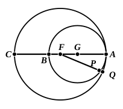

Subject to the same preliminary investigation as that required by Euclid's proof, the proposition can also be proved directly from III. 7.

For, by III. 7, $GH$ is the shortest straight line that can be drawn from $G$ to the circle with centre $F$;
therefore $GH$ is less than $GA$,
and therefore less than $GD$: which is absurd.

This proposition is the crucial one as regards circles which touch internally; and, when it is once established, the relative position of the circles can be completely elucidated by means of it and the propositions which have preceded it. Thus, in the annexed figure, if $F$ be the centre of the outer circle and $G$ the centre of the inner, and if any radius $FQ$ of the outer circle meet the two circles in $Q$, $P$ respectively, it follows, from III. 7, III. 8, or the corresponding theorem with reference to a point *on* the circumference, that $FA$ is the maximum straight line from $F$ to the circumference of the inner circle, $FP$ is less than $FA$, and $FP$ diminishes in length as $FQ$ moves round from $FA$ until $FP$ reaches its minimum length $FB$. Hence the circles do not meet at any other point than $A$, and the distance $PQ$ cut off between them on any radius $FQ$ of the outer circle becomes greater and greater as $FQ$ moves round from $FA$ to $FC$ and is a maximum when $FQ$ coincides with $FC$, after which it diminishes again on the other side of $FC$.

The same consideration gives the partial converse of III. 11 which forms the 6th lemma of Pappus to the first book of the *Tactiones* of Apollonius (Pappus, VII. p. 826). This is to the effect that, *if $AB$, $AC$ are in one straight line, and on one side of $A$, the circles described on $AB$, $AC$ as diameters touch (internally at the point $A$)*. Pappus concludes this from the fact that the circles have a common tangent at $A$; but the truth of it is clear from the fact that $FP$ diminishes as $FQ$ moves away from $FA$ on either side; whence the circles meet at $A$ but do not cut one another.

Pappus' 5th lemma (VII. p. 824) is another partial converse, namely that, *given two circles touching internally at $A$, and a line $ABC$ drawn from $A$ cutting both, then, if the centre of the outer circle lies on $ABC$, so does the centre of the inner*. Pappus himself proves this, by means of the common tangent to the circles at $A$, in two ways. (1) The tangent is at right angles to $AC$ and therefore to $AB$: therefore the centre of the inner circle lies on $AB$. (2) By III. 32, the angles in the alternate segments of both circles are right angles, so that $ABC$ is a diameter of both.

---

### [PROPOSITION 12.

*If two circles touch one another externally, the straight line joining their centres will pass through the point of contact.*

For let the two circles $ABC$, $ADE$ touch one another 5 externally at the point $A$, and let the centre $F$ of $ABC$, and the centre $G$ of $ADE$, be taken;
