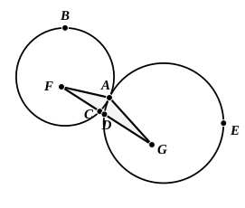

I say that the straight line joined from $F$ to $G$ will pass through the point of contact at $A$.

For suppose it does not, 10 but, if possible, let it pass as $FCDG$, and let $AF$, $AG$ be joined.

Then, since the point $F$ is the centre of the circle $ABC$,
15 $FA$ is equal to $FC$.

Again, since the point $G$ is the centre of the circle $ADE$,
$GA$ is equal to $GD$.

But $FA$ was also proved equal to $FC$;
20 therefore $FA$, $AG$ are equal to $FC$, $GD$,
so that the whole $FG$ is greater than $FA$, $AG$;
but it is also less [I. 20]: which is impossible.

Therefore the straight line joined from $F$ to $G$ will not fail to pass[^28_23] through the point of contact at $A$;
25 therefore it will pass through it.

Therefore etc.

Q. E. D.]

[^28_23]: **will not fail to pass.** The Greek has the double negative, οὐκ ἄρα ἡ...εὐθεῖα...οὐκ ἐλεύσεται, literally "the straight line...will not *not*-pass...."

---

Heron says on III. 11: "Euclid in proposition 11 has supposed the two circles to touch internally, made his proposition deal with this case and proved what was sought in it. *But I will show how it is to be proved if the contact is external.*" He then gives substantially the proof and figure of III. 12. It seems clear that neither Heron nor an-Nairīzī had III. 12 in this place.

Campanus and the Arabic edition of Naṣīraddīn aṭ-Ṭūsī have nothing more of III. 12 than the following addition to III. 11. "In the case of external contact the two lines $ae$ and $eb$ will be greater than $ab$, whence $ad$ and $cb$ will be greater than the whole $ab$, which is false." (The points $a$, $b$, $c$, $d$, $e$ correspond respectively to $G$, $F$, $C$, $D$, $A$ in the above figure.) It is most probable that Theon or some other editor added Heron's proof in his edition and made Prop. 12 out of it (an-Nairīzī, ed. Curtze, pp. 121—2). An-Nairīzī and Campanus, conformably with what has been said, number Prop. 13 of Heiberg's text Prop. 12, and so on through the Book.

What was said in the note on the last proposition applies, *mutatis mutandis*, to this. Camerer proceeds in the same manner as before; and we may use the same alternative argument in this case also.

Euclid's proof is valid provided only that, if $FG$, joining the assumed centres, meets the circle with centre $F$ in $C$ and the other circle in $D$, $C$ is not within the circle $ADE$ and $D$ is not within the circle $ABC$. (The proof is equally valid whether $C$, $D$ coincide or the successive points are, as drawn in the figure, in the order $F$, $C$, $D$, $G$.) Now, if $C$ is within the circle $ADE$
