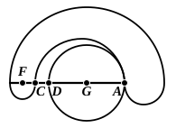

and $D$ within the circle $ABC$, the circles must have cut between $A$ and $C$ and between $A$ and $D$. Hence, as before, they must also have another corresponding point common on the other side of $CD$. That is, the circles must have *three* common points: which is impossible.

Hence Euclid's proof is valid if $F$, $A$, $G$ form a triangle, and the only hypothesis which has still to be disproved is the hypothesis which he would in any case have left to the reader, namely that $A$ does not lie on $FG$ but on $FG$ *produced* in either direction. In this case, as before, either $C$, $D$ must coincide or $C$ is nearer $F$ than $D$ is. Then the radius $FC$ must be equal to $FA$: which is impossible, since $FC$ cannot be greater than $FD$, and must therefore be *less* than $FA$.

Given the same preliminaries, III. 12 can be proved by means of III. 8.

Again, when the proposition III. 12 is once proved, III. 8 helps us to prove at once that the circles lie entirely outside each other and have no other common point than the point of contact.

Among Pappus' lemmas to Apollonius' *Tactiones* are the two partial converses of this proposition corresponding to those given in the last note. Lemma 4 (VII. p. 824) is to the effect that, *if $AB$, $AC$ be in one straight line, $B$ and $C$ being on opposite sides of $A$, the circles drawn on $AB$, $AC$ as diameters touch externally at $A$*. Lemma 3 (VII. p. 822) states that, *if two circles touch externally at $A$ and $BAC$ is drawn through $A$ cutting both circles and containing the centre of one, $BAC$ will also contain the centre of the other*. The proofs, as before, use the common tangent at $A$.

Mr H. M. Taylor gets over the difficulties involved by III. 11, 12 in a manner which is most ingenious but not Euclidean. He first proves that, *if two circles meet at a point not in the same straight line with their centres, the circles intersect at that point*; this is very easily established by means of III. 7, 8 and the third similar theorem. Then he gives as a corollary the statement that, *if two circles touch, the point of contact is in the same straight line with their centres*. It is not explained how this is inferred from the substantive proposition; it seems, however, to be a *logical* inference simply. By the proposition, every $A$ (circles meeting at a point not in the same straight line with the centre) is $B$ (circles which intersect); therefore every not-$B$ is not-$A$, i.e. circles which do not intersect do not meet at a point not in the same straight line with the centres. Now non-intersecting circles may either meet (i.e. touch) or not meet. In the former case they must meet *on* the line of centres: for, if they met at a point not in that line, they would intersect. But such a purely *logical* inference is foreign to Euclid's manner. As De Morgan says, "Euclid may have been ignorant of the identity of 'Every $X$ is $Y$' and 'Every not-$Y$ is not-$X$,' for anything that appears in his writings; he makes the one follow from the other by a new proof each time" (quoted in Keynes' *Formal Logic*, p. 81).

There is no difficulty in proving, by means of I. 20, Mr Taylor's next proposition that, *if two circles meet at a point which lies in the same straight line as their centres and is between the centres, the circles touch at that point, and each circle lies without the other*. But the similar proof, by means of I. 20, of the corresponding theorem for internal contact seems to be open to the same objection as Euclid's proof of III. 11 in that it assumes without proof that the circle which has its centre nearest to the point of meeting is the "inner" circle. Lastly, in order to prove that, *if two circles have a point of contact, they*
